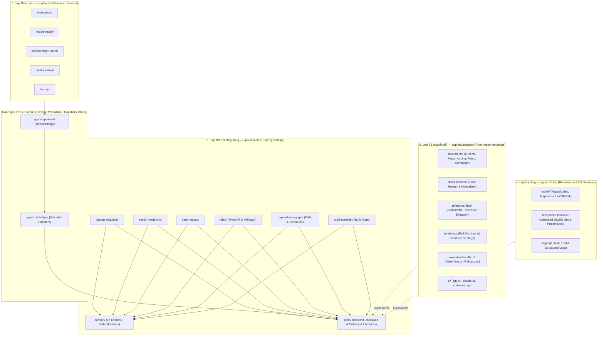

# 09 — Kiến trúc nền tảng và quy ước khởi tạo dự án DocFlow Studio

**Ngày biên soạn:** 25/11/2026 · **Phụ trách:** BA (`task-79ec37c0`)  
**Tài liệu căn cứ:** `docs/DOCFLOW_STUDIO_SPEC.md` (v1.0, §3.1, §5, §8, §9.1–9.4, §11, §15), `docs/08_DoiChieu_Spec_Va_KeHoach_Xay_App.md`, `docs/DocFlow_Interactive_Mockup.html` (chỉ đọc đối chiếu hiện trạng).  
**Đối tượng áp dụng:** Nhóm **Dev** và **QA** khi khởi tạo, phát triển và kiểm thử ứng dụng production trong `app/` (và các spike kỹ thuật nếu có).

> **Ký hiệu phân loại trong tài liệu:**
> - **[QS — Quan sát được trên Prototype]:** Hành vi hiện có trong `docs/DocFlow_Interactive_Mockup.html` và 4 ảnh `docs/mockup_*.png`.
> - **[ĐX — Đặc tả sản phẩm đề xuất / Mặc định khởi tạo]:** Chuẩn kiến trúc, mô hình miền, quy ước và giao diện IPC theo `DOCFLOW_STUDIO_SPEC.md` làm đầu vào xây dựng `app/`.
> - **[MỞ — Quyết định còn mở]:** Các điểm đang chờ người dùng chốt thêm (theo mã `L-xx`, `K-xx`, `M-xx` tại `docs/08_DoiChieu_Spec_Va_KeHoach_Xay_App.md`); cần thiết kế qua Port/Config để không khóa cứng.

---

## 1. Phân tách ranh giới: Prototype tham chiếu giao diện vs. Ứng dụng Production (`app/`)

### 1.1. Nguyên tắc bất biến đối với tài sản đặc tả và Prototype

1. **Tài liệu và ảnh tham chiếu chỉ đọc:** Tuyệt đối **không chỉnh sửa, ghi đè hoặc xóa** `docs/DOCFLOW_STUDIO_SPEC.md`, `docs/DocFlow_Interactive_Mockup.html` và 4 ảnh `docs/mockup_01_workspace.png`, `docs/mockup_02_recipe.png`, `docs/mockup_03_runner.png`, `docs/mockup_04_build.png`.
2. **Vai trò của Prototype:**
   - **[QS]** `docs/DocFlow_Interactive_Mockup.html` (116 dòng HTML/CSS/JS thuần, không framework, không bundler) là bản mô phỏng tương tác trong bộ nhớ trình duyệt (`window.app`, đối tượng `state`).
   - **[QS]** Prototype dùng số liệu giả lập cố định (`BASE_QTY=12000`, `BASE_PRICE=250000`, `BASE_RATE=0.65`), hàm tính JS cố định (`eval2..eval5`), số trang mô phỏng (`state.longContent ? 13 : 12` ở `createBuild()`), và xuất file JSON có nhãn `"Mockup-only — not a DOCX file"`.
   - **[ĐX]** Prototype và 4 ảnh `mockup_*.png` chỉ đóng vai trò **tham chiếu bố cục giao diện (UI/UX), luồng điều hướng 5 màn hình, token màu sắc và nhãn tiếng Việt (`vi-VN`)**. Tuyệt đối không chép các hàm tính toán cố định hay cơ chế giả lập số trang của prototype sang `app/` làm năng lực production.
3. **Phạm vi quy ước công cụ:**
   - Quy ước tại skill `prototype-conventions` (*không dùng framework, package manager hay lệnh test tự động*) chỉ áp dụng riêng cho `docs/DocFlow_Interactive_Mockup.html`.
   - Thư mục ứng dụng production `app/` sử dụng đầy đủ toolchain TypeScript, Electron, React, Zustand, SQLite, trình quản lý gói và bộ kiểm thử tự động (Vitest, Playwright).

### 1.2. Bảng đối chiếu ranh giới Prototype [QS] và Production `app/` [ĐX]

| Khía cạnh | Prototype tham chiếu (`docs/`) [QS] | Ứng dụng Production (`app/`) [ĐX] |
| --- | --- | --- |
| **Môi trường chạy** | File HTML đơn mở trên trình duyệt, trạng thái lưu trong RAM (`state`), tải lại trang là mất dữ liệu | Ứng dụng Desktop **Electron + React + TypeScript + Zustand**, chạy **offline-first** |
| **Mẫu tài liệu (`Template V0`)** | Chỉ là nhãn chữ `"Mẫu DOCX V0"` và hằng số hiển thị | File DOCX thật nhập vào kho bất biến (`template/original.docx`), khóa cứng mã băm `sha256`, quyền chỉ đọc |
| **Nguồn dữ liệu bổ trợ** | Ô nhập số trực tiếp trên giao diện; không đọc file Excel/DOCX/PDF | Nhập file thật vào kho định danh theo nội dung (`sources/<sourceId>/<sha256>/`), lưu `SourceArtifact` và `DataBinding` có provenance |
| **Định vị nội dung** | Mảng 5 phần cố định (`secNames` 01..05) | Parse cấu trúc OOXML thành cây `DocumentBlock`, ánh xạ `LogicalSection` qua `startAnchor` / `endAnchor` và `anchorFingerprint` (`Section != Page`) |
| **Thực thi quy tắc (Rule)** | Hàm JS cố định trong HTML; văn bản Rule chỉ để trưng bày | Biên dịch sang **Typed Rule IR** (4 bước: trích xuất, quan hệ, tính toán số học chính xác `Decimal`, viết lại nhận xét); cấm `eval()`, chạy trong local sandbox |
| **Đồ thị phụ thuộc (DAG)** | Hàm `stale()` viết cứng cho Phần 02..05 | Đồ thị động từ `DependencyEdge` (`SOURCE`, `VALUE`, `RULE`, `SECTION`, `BUILD`), phát hiện chu trình, chạy `Selected` / `Affected` / `Full` kèm `resultFingerprint` |
| **Chỉnh sửa & Xuất DOCX** | Không đọc/ghi DOCX; không tạo file Word | Clone `Template V0` sang bản làm việc, áp tập OOXML Patch nguyên tử bảo toàn `rPr`/`pPr`/`tblPr`, cập nhật fields/TOC, xuất DOCX hoàn chỉnh |
| **Phân trang & Diff** | Hằng số 12 hoặc 13 trang; tab `Content Diff` / `Layout Diff` chỉ là khung chữ | Render toàn bộ DOCX đã patch qua Layout Engine thật để lấy số trang và tọa độ; tách bạch **Value/Content/Table Diff** với **Layout Diff** (`SHIFTED`, `OVERFLOW`...) |
| **Lưu trữ & Tái lập** | Mảng tạm trong RAM; tải JSON mẫu | `project.sqlite` (giao dịch nguyên tử, migrations) + kho artifact `sha256` + `BuildManifest` tái dựng được đúng bản build cũ |

---

## 2. Quyết định mặc định khởi tạo dự án (theo Spec §15)

Dựa trên đề xuất mặc định tại `DOCFLOW_STUDIO_SPEC.md` §9.2 và §15, dự án khởi tạo `app/` thống nhất các quyết định nền tảng sau làm chuẩn mặc định [ĐX] (các biến thể còn mở [MỞ] được cô lập sau các interface `ports/`):

| Hạng mục | Quyết định mặc định khởi tạo [ĐX] | Ghi chú kỹ thuật & Điểm mở [MỞ] |
| --- | --- | --- |
| **1. Nền tảng & UI Stack** | **Electron + React + TypeScript + Zustand**, kiến trúc **offline-first** | Giao diện chỉ tiếng Việt, định dạng số/tiền/ngày chuẩn `vi-VN`. Phát hành ưu tiên macOS trước, giữ mã `core/` độc lập hệ điều hành để mở rộng Windows (`K-01` [MỞ]). |
| **2. Bảo mật tiến trình Electron** | Renderer bật `contextIsolation: true`, `sandbox: true`, tắt `nodeIntegration: false`, áp đặt CSP chặt | UI tuyệt đối không gọi trực tiếp `fs`, `child_process`, SQLite hay CLI; mọi giao tiếp đi qua `preload` (`contextBridge`) và kênh IPC có kiểm tra schema. |
| **3. Cơ sở dữ liệu cục bộ** | **SQLite** (`project.sqlite`) kèm hệ thống schema migrations và giao dịch nguyên tử (ACID) | Lưu metadata thực thể miền, trạng thái vòng đời, lịch sử kiểm toán (`AuditEvent`) và khóa dự án chống mở trùng nhiều tiến trình. |
| **4. Kho lưu trữ Artifact** | **Content-addressed storage theo `sha256`** trên hệ thống file cục bộ | Áp dụng cho `Template V0`, `Source Snapshot` (Excel/DOCX/PDF) và `BuildArtifact`. Đảm bảo tính bất biến và khả năng tái lập (`Reproducible builds`). |
| **5. Bất biến Mẫu & Nguồn** | `Template V0` và mọi `Source Snapshot` là **chỉ đọc (read-only)**; không ghi ngược kết quả vào file Excel nguồn | Khi build hoặc xem trước, luôn clone `Template V0` ra vùng tạm/working rồi mới áp OOXML Patch. Kiểm tra lại `sha256` trước khi chạy Rule hoặc Build. |
| **6. Bộ thực thi Rule (Executor)** | **Typed Rule IR + Deterministic Sandbox cục bộ**; số học tiền tệ dùng kiểu `Decimal` (không dùng `float` IEEE-754, không dùng `eval()`, không chạy macro Office) | Mặc định chạy offline cục bộ. AI/LLM chỉ tham gia diễn giải yêu cầu tự nhiên sang đề xuất Rule IR và soạn câu chữ nhận xét từ con số đã tính (`K-04`). |
| **7. Cơ chế Phê duyệt** | **Human-approved Section Revisions**: bản nháp tính toán không tự động ghi đè bản đã duyệt | Mọi kết quả sửa trực tiếp hoặc tính lại đều cần người dùng duyệt rõ ràng. Khi đầu vào đổi, bản duyệt cũ được giữ làm lịch sử nhưng không hợp lệ cho bản build mới (§1.2). Chi tiết vai trò/override tách theo cấu hình chính sách (`L-02`, `L-05`, `K-05` [MỞ]). |
| **8. Dựng & Kiểm tra Layout** | **Full-document render trước khi xuất** thông qua `DocumentLayoutRendererPort` (Strategy pattern) | Không cắt/ghép DOCX theo trang (`Section != Page`). Cùng một engine render tạo PDF/ảnh preview và báo cáo `LayoutIssue` + danh sách font phụ thuộc (hướng ưu tiên LibreOffice headless theo Q10/`L-03`, đóng gói sau Port để thay đổi được). |
| **9. Lưu trữ ngữ cảnh dài hạn** | Lưu toàn bộ Recipe, Snapshots, Decisions, Revisions, Runs, Builds vào SQLite + thư mục dự án (§11) | Tuyệt đối **không** dùng lịch sử hội thoại chat của AI làm nơi lưu trạng thái duy nhất để tái dựng tài liệu. |

---

## 3. Kiến trúc Ports & Adapters 4 phân lớp trong `app/` (theo Spec §9.1–9.3)

### 3.1. Sơ đồ kiến trúc phân lớp và chiều phụ thuộc



*(Lưu ý: Thư mục khởi động `app/src/main/` đóng vai trò **Composition Root** của tiến trình Electron Main — chỉ khởi tạo cửa sổ, tiêm phụ thuộc `Adapters` + `Infra` vào `Core` và đăng ký `IPC`, tuyệt đối không chứa logic nghiệp vụ).*

### 3.2. Cấu trúc thư mục chuẩn của `app/` và trách nhiệm từng phân lớp

```text
app/
  package.json
  tsconfig.json
  src/
    main/                         # Composition Root của Electron Main Process (khởi tạo cửa sổ, DI wiring)
    preload/                      # contextBridge phơi bày API hẹp, định kiểu chặt cho Renderer
    ui/                           # [Lớp 1] Giao diện người dùng (React + Zustand, định dạng vi-VN)
      workspace/                  #   Màn 01: Bố cục 3 cột chỉnh sửa Section + Change Tray (§4.1)
      recipe-studio/              #   Màn 02: Định nghĩa Saved Rule, AI diễn giải, Nguồn, Công thức, Kiểm thử, Quan hệ (§4.2)
      dependency-runner/          #   Màn 03: Đồ thị DAG, Execution Plan, chạy Selected/Affected/Full, Evidence (§4.3)
      build-preview/              #   Màn 04: Build Manifest, Preview trang render thật, Content Diff vs Layout Diff, Xuất DOCX (§4.4)
      history/                    #   Màn 05: Timeline kiểm toán, mở Build Snapshot cũ, tạo nhánh chỉnh sửa (§4.5)
      shared/                     #   Components dùng chung, bảng nhãn trạng thái tiếng Việt, formatter vi-VN
    core/                         # [Lớp 2] Trái tim nghiệp vụ (TypeScript thuần, độc lập công nghệ ngoài)
      domain/                     #   17 thực thể miền (§5), Value Objects (Sha256, Money/Decimal), 6 State Machines (§3.1)
      change-requests/            #   Quản lý yêu cầu thay đổi (ChangeRequest)
      section-revisions/          #   Quản lý bản sửa theo phần, Content/Value/Table Diff, quy trình phê duyệt
      data-registry/              #   Quản lý nguồn (SourceArtifact), DataDefinition, DataRevision, DataBinding
      rules/                      #   SavedRule, kiểm tra schema/kiểu/đơn vị của Typed Rule IR, quản lý phiên bản Rule
      dependency-graph/           #   Xây dựng DAG, phát hiện vòng lặp, lan truyền STALE, lập lịch topological, tính fingerprint
      build-manifest/             #   Kiểm tra cổng chất lượng Build (Build Gate), khóa manifest, đối chiếu Layout Diff
      ports/                      #   Giao diện cổng ra (DocumentEnginePort, LayoutRendererPort, SpreadsheetPort, SandboxExecutorPort, AiAssistantPort, ArtifactStorePort, RepositoryPorts...)
    adapters/                     # [Lớp 3] Cài đặt giao tiếp công cụ chuyên biệt (Strategy / Ports & Adapters)
      documents/                  #   Đọc cây OOXML, định vị LogicalSection anchor, áp lệnh OOXML Patch, ghép bản làm việc
      rendering/                  #   Strategy kết xuất toàn tài liệu ra PDF/ảnh + đo tọa độ trang/bảng/font (vd: LibreOffice headless)
      spreadsheets/               #   Đọc Excel (.xlsx), chuẩn hóa kiểu ngày/số/công thức/sheet ẩn, trích dẫn ô nguồn
      reference-files/            #   Đọc DOCX/PDF tham chiếu kèm vị trí trang/đoạn làm provenance
      ai/
        agy-cli/                  #   Strategy Adapter tích hợp Google Antigravity CLI (`agy`) / SDK
        claude-cli/               #   Strategy Adapter tích hợp Claude CLI
        codex-cli/                #   Strategy Adapter tích hợp Codex CLI
        api/                      #   Strategy Adapter gọi HTTP/Model API trực tiếp (khi được bật)
      execution/
        sandbox/                  #   Thực thi tất định Typed Rule IR trong môi trường cô lập, không mạng, chỉ đọc snapshot
    infra/                        # [Lớp 4] Hạ tầng lưu trữ, giao tiếp liên tiến trình và nhật ký hệ thống
      sqlite/                     #   Kết nối SQLite, schema migrations, giao dịch nguyên tử, cài đặt Repository
      filesystem/                 #   Kho lưu trữ content-addressed theo sha256, phân quyền read-only file gốc, file khóa dự án
      ipc/                        #   Bộ định tuyến IPC, xác thực payload (Zod/JSON Schema), gán mã lỗi chuẩn và ghi audit
      logging/                    #   Ghi nhật ký hệ thống có cấu trúc và nhật ký kiểm toán bất biến
```

### 3.3. Quy tắc ranh giới phụ thuộc bắt buộc (Dependency Rule)

Nhóm Dev phải cấu hình linter (ví dụ `eslint-plugin-boundaries` hoặc `no-restricted-imports`) và nhóm QA kiểm tra tự động các ràng buộc kiến trúc sau:

1. **`core/` hoàn toàn tinh khiết (Zero Infrastructure Dependency):**
   - `app/src/core/**` **CẤM import** `electron`, `react`, `react-dom`, `zustand`, `fs`, `fs/promises`, `path` (hệ điều hành cụ thể), `child_process`, `better-sqlite3`, hoặc bất kỳ module nào từ `ui/`, `adapters/`, `infra/`, `main/`, `preload/`.
   - Mọi tương tác I/O, đọc/ghi file, gọi DB, gọi engine DOCX hay AI đều phải đi qua interface khai báo trong `app/src/core/ports/`.
2. **`ui/` tách biệt hoàn toàn với hệ thống tệp và nghiệp vụ lõi ngầm:**
   - `app/src/ui/**` **CẤM import** từ `adapters/`, `infra/sqlite/`, `infra/filesystem/`, `main/`, hoặc thư viện Node.js.
   - `ui/` chỉ được phép import kiểu dữ liệu (DTO / type-only imports) và gọi hành động qua `window.docflowApi` do `preload/` cung cấp.
   - `ui/` không tự tính lại doanh thu/chi phí/lợi nhuận hay tự suy diễn trạng thái `STALE` khác với kết quả trả về từ `core/`.
3. **`adapters/` và `infra/` phụ thuộc hướng vào `core/ports/`:**
   - Các adapter không gọi chéo nhau trực tiếp (ví dụ: `adapters/ai/*` không được tự gọi `adapters/documents/*` để ghi file DOCX, mà chỉ trả về Proposal cho `core/` điều phối).
4. **Thực thi tác vụ nặng ngoài luồng giao diện:**
   - Parse DOCX lớn, chạy Rule hàng loạt và render PDF phân trang phải chạy bất đồng bộ ở Main/Worker/tiến trình con có hỗ trợ hủy (`run.cancel`) và timeout, không bao giờ chặn luồng UI Renderer.

---

## 4. Quy tắc bất biến cho `Template V0`, `Source Snapshot` và Cấu trúc thư mục dữ liệu dự án

### 4.1. Quy tắc bất biến `Template V0` và `Source Snapshot`

1. **Khi nhập `Template V0` (`project.importTemplate`):**
   - Đọc luồng byte của file DOCX gốc do người dùng chọn, tính mã băm `sha256` đầy đủ (64 ký tự hex).
   - Sao chép nguyên vẹn vào `template/original.docx` (hoặc kho đối tượng theo hash), ghi `template/template-sha256.txt` và đặt cờ quyền tệp chỉ đọc (`chmod 444` trên Unix / thuộc tính read-only trên Windows).
   - File DOCX ban đầu bên ngoài thư mục dự án của người dùng không bao giờ bị sửa đổi.
2. **Khi nhập `Source Snapshot` (`project.addSource`):**
   - Mọi file Excel, DOCX, PDF tham chiếu khi đưa vào dự án đều được băm `sha256` và lưu cô lập tại `sources/<sourceId>/<sha256>/source.<ext>`, đặt quyền chỉ đọc.
   - Nếu người dùng cập nhật lại file Excel cùng tên nhưng nội dung đổi (`sha256` mới), hệ thống tạo một phiên bản `SourceArtifact` mới với đường dẫn `<sha256>` mới, **giữ nguyên snapshot cũ** để các `BuildManifest` trước đó vẫn tái dựng được.
3. **Cơ chế bảo vệ kép lúc chạy (Runtime Verification):**
   - Trước mọi lần thực thi `run.execute` hoặc `build.renderPreview` / `build.exportDocx`, lớp `infra/filesystem` phải tính lại `sha256` thực tế của `template/original.docx` và các `sources/` liên quan, đối chiếu với giá trị đã ghi trong SQLite. Nếu sai lệch, lập tức chặn thao tác với mã lỗi `ARTIFACT_INTEGRITY_VIOLATION`.
   - Không có bất kỳ kênh IPC, hàm Repository hay công cụ AI nào cung cấp phương thức ghi đè (`overwrite` / `updateInPlace`) lên `template/original.docx` và `sources/<sourceId>/<sha256>/*`.
4. **Cơ chế Patch không cắt trang (`Section != Page`):**
   - Cấm tách tài liệu mẫu thành các file rời kiểu `section-01.docx`, `section-02.docx` để ghép lại (§5.3, §8.1).
   - Lưu thay đổi dưới dạng tập lệnh Patch theo `blockId` (`replaceText`, `replaceRuns`, `setCellValue`, `insertParagraphAfter`, `removeBlock`, `replaceTableRows`, `replaceImage`, `setStyle`). Khi dựng bản xem trước hoặc xuất tài liệu, luôn **clone `template/original.docx` ra bản làm việc mới** rồi áp tuần tự các Patch đã `APPROVED`.

### 4.2. Cấu trúc thư mục dữ liệu của một dự án (theo Spec §5.3)

Thư mục dữ liệu dự án nằm ở không gian người dùng chọn (tách biệt hoàn toàn khỏi thư mục mã nguồn repo `docflow-studio/`):

```text
<thu-muc-du-an>/
  manifest.json                           # Metadata nhận diện dự án, phiên bản schema thư mục, thời điểm tạo
  .project.lock                           # Khóa phiên làm việc đơn (ngăn 2 cửa sổ/tiến trình sửa cùng lúc)
  project.sqlite                          # CSDL chính lưu 17 thực thể miền, trạng thái, quan hệ DAG và Audit Log
  template/
    original.docx                         # Bản sao DOCX mẫu gốc V0 — CHỈ ĐỌC, bất biến
    template-sha256.txt                   # Mã băm sha256 cố định của original.docx
    parsed-document.json                  # Cây cấu trúc OOXML blocks, styles, bookmarks, anchors đã phân tích
  sources/
    <sourceId>/
      <sha256>/
        source.<xlsx|docx|pdf>            # Bản chụp nguồn dữ liệu theo nội dung — CHỈ ĐỌC, bất biến
        schema-sample.json                # Metadata sheet, vùng, cột, đơn vị và mẫu dòng phục vụ DataBinding
  recipe/
    recipe-v<N>.json                      # Bản chụp toàn bộ Recipe theo phiên bản (rules + bindings + edges)
    rules/
      <ruleId>/
        <version>.json                    # Định nghĩa SavedRule (textInstruction, ioSchema, Typed IR, testCases)
  sections/
    <sectionId>/
      revisions/
        <revisionId>.json                 # Bản ghi SectionRevision (inputFingerprint, outputs, patchSet, approval)
  runs/
    <runId>/
      plan.json                           # Kế hoạch thực thi (mode, topological order, cached vs executed nodes)
      evidence.json                       # Bằng chứng tính toán từng RunStep (dòng nguồn khớp, giá trị trung gian)
      log.json                            # Nhật ký thời gian chạy, cảnh báo và chi tiết lỗi/mơ hồ
  working/                                # Vùng nháp tạm thời khi clone V0 để kiểm tra nhanh (có thể dọn dẹp)
  builds/
    <buildId>/
      manifest.json                       # BuildManifest khóa cứng mọi hash đầu vào, ruleVersions, selectedRevisions
      output.docx                         # Tài liệu DOCX hoàn chỉnh sinh từ bản sao V0 + các Patch hợp lệ
      preview.pdf                         # Bản PDF kết xuất từ chính output.docx bởi Layout Engine đã ghim
      layout-report.json                  # Báo cáo số trang, vị trí trang từng Section, font, Content/Layout Diff, LayoutIssues
```

> **Ghi chú điểm mở [MỞ]:** Quy tắc đặt định danh `<buildId>` (ví dụ `build-0001` theo spec §5.3 hay `B-001` theo Q11/`L-12`) và quy tắc dọn rác đếm tham chiếu khi người dùng xóa lịch sử (`L-04`) được cấu hình tập trung tại `core/build-manifest` và `infra/filesystem`.

---

## 5. Bảng trạng thái vòng đời tách biệt (theo Spec §3.1 & §3.2)

### 5.1. Sáu nhóm trạng thái vòng đời độc lập

Hệ thống **cấm gộp chung** trạng thái tính toán, trạng thái phê duyệt nội dung và trạng thái bố cục trang vào một trường duy nhất. Mã lưu trong CSDL/IPC dùng hằng số tiếng Anh viết hoa theo Spec §3.1; giao diện người dùng hiển thị nhãn tiếng Việt tương ứng:

| STT | Nhóm đối tượng | Tập mã trạng thái chuẩn (Spec §3.1) | Nhãn hiển thị tiếng Việt [ĐX] | Ý nghĩa & Quy tắc nghiệp vụ cốt lõi |
| --- | --- | --- | --- | --- |
| 1 | **Rule** (`SavedRule`) | `DRAFT`, `VALIDATED`, `APPROVED`, `DEPRECATED` | Nháp, Đã kiểm thử, Đã duyệt, Ngừng dùng | Phản ánh quy tắc nghiệp vụ đã biên dịch sang Typed IR, vượt qua kiểm thử và sẵn sàng dùng cho sản xuất hay chưa. Sửa mô tả Rule tạo version mới ở `DRAFT`, không tự áp ngầm vào kết quả cũ. |
| 2 | **Input / Binding** (`DataBinding`) | `READY`, `MISSING`, `AMBIGUOUS`, `CHANGED` | Sẵn sàng (Đã liên kết), Thiếu dữ liệu, Mơ hồ, Đã thay đổi | Đánh giá khả năng truy xuất dữ liệu từ `SourceArtifact`. Khi nguồn thiếu dòng hoặc trùng ngày hiệu lực (`AMBIGUOUS`), bộ thực thi phải dừng an toàn thay vì đoán số. |
| 3 | **Calculation Result** (Kết quả tính) | `NOT_RUN`, `STALE`, `RUNNING`, `FAILED`, `RESULT_READY`, `APPROVED` | Chưa chạy, Cần tính lại, Đang chạy, Lỗi thực thi, Đã có kết quả (Chờ duyệt), Đã duyệt | Phản ánh hiệu lực tính toán của số liệu/Section, **hoàn toàn độc lập với bố cục trang**. Khi upstream đổi, các node phụ thuộc chuyển sang `STALE`. |
| 4 | **Section Revision** (Bản sửa phần) | `DRAFT`, `REVIEW_REQUIRED`, `APPROVED`, `SUPERSEDED` | Bản nháp, Chờ duyệt, Hợp lệ (Đã duyệt), Đã thay thế | Quản lý vòng đời đề xuất nội dung và phê duyệt của từng phần. Khi có Revision mới được duyệt, bản duyệt trước đó chuyển sang `SUPERSEDED` (vẫn giữ để tra cứu lịch sử). |
| 5 | **Document Build** (Bản dựng tài liệu) | `BLOCKED`, `BUILDING`, `RENDERED`, `LAYOUT_REVIEW`, `APPROVED`, `EXPORTED` | Bị chặn, Đang dựng, Đã kết xuất, Xem xét bố cục, Đã duyệt bản dựng, Đã xuất DOCX | Quản lý vòng đời của toàn bộ tài liệu hoàn chỉnh. Bị `BLOCKED` nếu còn bất kỳ phần bắt buộc nào đang `STALE`, `FAILED` hoặc chưa có Revision `APPROVED`. |
| 6 | **Layout Difference** (Khác biệt bố cục) | `SHIFTED`, `SPLIT_CHANGED`, `OVERFLOW`, `EMPTY_PAGE`, `NO_CHANGE` | Dịch trang, Đổi điểm ngắt bảng/đoạn, Tràn lề, Trang trắng dư, Không đổi bố cục | Phản ánh sự thay đổi vị trí vật lý sau khi render toàn bộ tài liệu (ví dụ `SHIFTED`: Section 03 dời từ trang 7 sang trang 8 do Section 01 dài ra), tách biệt tuyệt đối với `Content Diff`. |

### 5.2. Hợp đồng lan truyền mất hiệu lực (Invalidation) và Cổng chất lượng Build

1. **Lan truyền `STALE` có mục tiêu:** Khi một `DataRevision`, `SourceArtifact` hoặc `SavedRule` thay đổi, hệ thống duyệt đồ thị DAG theo chiều xuôi (transitive downstream) để đánh dấu `STALE` đúng các kết quả bị ảnh hưởng; **không xóa** các `SectionRevision` cũ đã duyệt nhưng đánh dấu chúng không còn hợp lệ để đưa vào bản build mới.
2. **Chặn thực thi khi đầu vào thượng nguồn chưa đồng bộ:**
   - Nếu chạy `Selected Section` ở Section 02, chỉ Section 02 có kết quả mới; các phần hạ nguồn (Section 03–05) vẫn giữ `STALE` và cổng Build vẫn bị `BLOCKED`.
   - Nếu yêu cầu chạy riêng Section 03 khi Section 02 đang `STALE`, hệ thống phải chặn thực thi (hoặc buộc người dùng chọn chạy kèm phần upstream) thay vì âm thầm tính trên dữ liệu cũ.
3. **Tránh tạo Diff giả khi giá trị không đổi:** Nếu chạy lại mà giá trị đầu ra và văn bản thực tế trùng khớp hoàn toàn với bản trước, hệ thống vẫn lưu bản ghi `Run` + `RunStep` kèm provenance mới nhưng tránh sinh `Content Diff` thừa (§3.2).
4. **Phát hiện vòng lặp phụ thuộc:** Khi lưu `SavedRule` hoặc `DependencyEdge`, nếu phát hiện chu trình (`A → B → A`), hệ thống từ chối lưu ngay với mã lỗi `DEPENDENCY_CYCLE_DETECTED`.
5. **Điểm mở cần cấu hình dẻo [MỞ]:**
   - `L-06`: Xác định `STALE` thuần theo sự kiện thay đổi (Q2) kết hợp `resultFingerprint` làm bộ nhớ đệm phép tính.
   - `L-02` & `L-07`: Hành vi cổng xuất khi phát hiện `LayoutIssue` nghiêm trọng hoặc khi phân trang thay đổi (chỉ cảnh báo theo Q6, thu hồi duyệt Section theo Q7, hay yêu cầu xác nhận override có lưu vết theo Spec §8.3/AC14). Thiết kế `BuildGatePolicy` trong `core/build-manifest/` dưới dạng chính sách cấu hình được để đáp ứng cả hai chế độ mà không phải sửa kiến trúc lõi.

---

## 6. Mô hình dữ liệu miền cốt lõi — 17 Thực thể (theo Spec §5)

Toàn bộ 17 thực thể miền tại `DOCFLOW_STUDIO_SPEC.md` §5 được định nghĩa kiểu tĩnh trong `app/src/core/domain/` và ánh xạ bền vững xuống `project.sqlite` cùng cây thư mục dự án:

| STT | Thực thể (Entity) | Module sở hữu (`core/`) | Các trường tối thiểu bắt buộc | Ràng buộc toàn vẹn & Lưu trữ |
| --- | --- | --- | --- | --- |
| 1 | `Project` | `domain/` | `id`, `title`, `status`, `currentRecipeVersion`, `createdAt`, `updatedAt` | Không gian làm việc gốc; ánh xạ 1-1 với một thư mục dự án và `manifest.json`. |
| 2 | `TemplateArtifact` | `domain/` | `id`, `path`, `sha256`, `parsedAt`, `ooxmlMap` | **Chỉ đọc.** Lưu tham chiếu tới `template/original.docx` và `parsed-document.json`. |
| 3 | `SourceArtifact` | `data-registry/` | `id`, `type` (`EXCEL` \| `DOCX` \| `PDF` \| `CSV`), `path`, `version`, `sha256`, `importedAt` | **Chỉ đọc.** Mỗi phiên bản nội dung mới sinh một bản ghi snapshot mới theo `sha256`. |
| 4 | `LogicalSection` | `domain/` | `id`, `parentId`, `title`, `order`, `startAnchor`, `endAnchor` | Đơn vị nghiệp vụ của tài liệu. **Cấm dùng số trang làm định danh (`id`).** |
| 5 | `DocumentBlock` | `domain/` | `id`, `sectionId`, `ooxmlLocator`, `type`, `styleRef`, `anchorFingerprint` | Đại diện đoạn văn (`paragraph`), bảng (`table`), hình (`image`), SDT/range trong OOXML. |
| 6 | `DataDefinition` | `data-registry/` | `key`, `dataType`, `unit`, `validation`, `defaultPolicy` | Khai báo biến dữ liệu có kiểu và đơn vị chuẩn (ví dụ: `production.quantity`, đơn vị `product`). |
| 7 | `DataRevision` | `data-registry/` | `id`, `key`, `value`, `provenance`, `status`, `version`, `createdAt` | Lịch sử mỗi lần thay đổi giá trị đầu vào hoặc kết quả trung gian có truy vết nguồn gốc. |
| 8 | `DataBinding` | `data-registry/` | `id`, `sourceId`, `rangeSelector`, `lookupSpec`, `priority`, `version`, `status` | Liên kết biến dữ liệu/Section tới vùng sheet, cột khóa và quy tắc chọn bản ghi của `SourceArtifact`. |
| 9 | `ChangeRequest` | `change-requests/` | `id`, `sectionId`, `prompt`, `changeKind`, `status`, `createdAt` *(mở rộng [ĐX] theo Q21: `affectedScope`, `updatedAt`, `oldValue`, `newValue`, `linkedBuildId`)* | Yêu cầu chỉnh sửa một lần của người dùng gắn với Section hoặc phạm vi ảnh hưởng. |
| 10 | `SavedRule` | `rules/` | `id`, `version`, `textInstruction`, `ioSchema`, `executionPlan` (Typed IR), `testCases`, `status`, `requiresHumanReview` | Quy tắc nghiệp vụ tái sử dụng; mỗi phiên bản lưu bất biến tại `recipe/rules/<ruleId>/<version>.json`. |
| 11 | `DependencyEdge` | `dependency-graph/` | `id`, `fromId`, `toId`, `type` (`USES` \| `PRODUCES` \| `REFERENCES` \| `REWRITES`), `condition`, `discoveredBy`, `approved` | Cạnh có hướng nối giữa các đỉnh `SOURCE`, `VALUE`, `RULE`, `SECTION`, `BUILD`; không được tạo chu trình. |
| 12 | `Run` | `dependency-graph/` | `id`, `mode` (`SELECTED` \| `AFFECTED` \| `FULL`), `planHash`, `snapshotId`, `startedAt`, `completedAt`, `result` | Phiên thực thi có thể truy vết đầy đủ tại `runs/<runId>/plan.json` và `log.json`. |
| 13 | `RunStep` | `dependency-graph/` | `id`, `runId`, `ruleId`, `inputHashes`, `outputHash`, `resultFingerprint`, `evidence`, `errors` | Bằng chứng tính toán chi tiết từng bước (dòng Excel đã tra, phép tính trung gian, kiểm tra đơn vị). |
| 14 | `SectionRevision` | `section-revisions/` | `id`, `sectionId`, `baseTemplateHash`, `ruleId`, `ruleVersion`, `inputFingerprint`, `outputs`, `patchSet`, `reviewStatus`, `approval` | Đề xuất thay đổi độc lập cho một Section, chứa mảng lệnh OOXML Patch theo `blockId`. |
| 15 | `BuildManifest` | `build-manifest/` | `id`, `templateHash`, `sourceSnapshotIds`, `recipeVersion`, `ruleVersions`, `selectedRevisions`, `layoutPolicy`, `rendererInfo` | Bộ đầu vào khóa cứng đảm bảo tính tái lập hoàn toàn của một bản dựng tài liệu. |
| 16 | `BuildArtifact` | `build-manifest/` | `id`, `manifestId`, `docxPath`, `pdfPreviewPath`, `checksum` (`sha256`), `pageCount`, `layoutReport`, `createdAt` | Kết quả đầu ra thực tế (`output.docx`, `preview.pdf`) tạo từ `BuildManifest`. |
| 17 | `LayoutIssue` | `build-manifest/` | `id`, `buildId`, `sectionId`, `blockId`, `type`, `severity`, `pageRange`, `detail` | Cảnh báo/vấn đề phân trang phát hiện sau khi render (tràn bảng, tiêu đề cuối trang, trang trắng, thiếu font). |

*(Ngoài 17 thực thể miền cốt lõi trên, lớp hạ tầng duy trì bảng nhật ký bất biến `AuditEvent` để ghi vết toàn bộ lệnh thay đổi trạng thái qua IPC).*

---

## 7. Danh mục API / IPC chính và Khung Validation, Phân quyền, Mã lỗi (theo Spec §9.4)

### 7.1. Quy ước chung cho mọi lệnh IPC (`Renderer ↔ Main`)

Mọi kênh IPC đăng ký tại `app/src/infra/ipc/` phải tuân thủ 4 chốt chặn bắt buộc của Spec §9.4:

1. **Schema Validation đầu vào/đầu ra:** Kiểm tra chặt kiểu dữ liệu, độ dài chuỗi, định dạng ID và đường dẫn tệp (chống Path Traversal `..`) bằng schema validator (ví dụ `zod`) ngay tại cổng IPC trước khi gọi vào `core/`.
2. **Capability Scoping (Giới hạn quyền theo tác nhân gọi):** Mỗi lệnh gắn nhãn quyền tối thiểu (ví dụ `ui:user`, `agent:analyst:read`, `agent:planner:propose`, `agent:writer:propose`). Các AI Adapter **không bao giờ** có quyền gọi các lệnh phê duyệt (`section.approveRevision`, `build.approve`) hoặc xuất file (`build.exportDocx`).
3. **Chuẩn hóa phản hồi Envelope (`IpcResult<T>`):** Không ném lỗi thô chưa kiểm soát qua biên IPC; luôn trả về cấu trúc đồng nhất kèm `correlationId` và `auditEventId`.
4. **Audit Metadata tự động:** Mọi lệnh ghi (`mutating command`) tự động sinh bản ghi kiểm toán gồm `timestamp`, `actorType` (`USER` hoặc `AI_AGENT:<role>`), `command`, `targetEntityId`, `inputHash` và kết quả.

```typescript
// Hợp đồng kiểu phản hồi chuẩn tại biên IPC (minh họa quy ước cho Dev/QA)
export type IpcSuccess<T> = {
  ok: true;
  data: T;
  meta: { correlationId: string; timestamp: string; auditEventId?: string };
};

export type IpcFailure = {
  ok: false;
  error: {
    code: DocFlowErrorCode;
    messageVi: string;              // Thông báo rõ ràng bằng tiếng Việt cho UI
    details?: Record<string, unknown>; // Ví dụ: file, sheet, row, upstreamSectionIds, fieldErrors
    recoverable: boolean;
  };
  meta: { correlationId: string; timestamp: string };
};
```

### 7.2. Danh mục đầy đủ các nhóm lệnh API / IPC chính (Spec §9.4)

| Nhóm | Tên kênh / API chuẩn | Đầu vào chính (Validated Payload) | Đầu ra chính | Quyền gọi cho phép (`Capability`) |
| --- | --- | --- | --- | --- |
| **1. Dự án & Nguồn** | `project.create` / `project.open` | `{ projectDir, title? }` | `ProjectSummary` | `ui:user` |
| | `project.importTemplate` | `{ filePath }` | `{ templateId, sha256, parseReport, sections }` | `ui:user` *(chỉ đọc file gốc, lưu V0 bất biến)* |
| | `project.addSource` | `{ filePath, sourceKey?, type? }` | `{ sourceArtifact, sha256, schemaSample, affectedNodes }` | `ui:user` |
| **2. Section & Định vị** | `section.list` | `{ projectId }` | `LogicalSectionSummary[]` | `ui:user`, `agent:read` |
| | `section.get` | `{ sectionId, includeBlocks? }` | `LogicalSectionDetail` | `ui:user`, `agent:read` |
| | `section.resolveAnchor` | `{ sectionId }` / `{ blockId }` | `AnchorResolutionReport` (kèm kiểm tra drift) | `ui:user`, `agent:doc-analyst` |
| | `section.updateBoundaries` | `{ sectionId, startAnchor, endAnchor, title? }` | `LogicalSectionSummary[]` | `ui:user` *(AI chỉ đề xuất, người dùng chốt)* |
| **3. Yêu cầu sửa** | `change.create` | `{ sectionId, instruction, scope, changeKind }` | `ChangeRequest` + danh sách node `STALE` (nếu sửa số trực tiếp) | `ui:user` |
| **4. Quy tắc (Rule)** | `rule.proposeFromInstruction` | `{ sectionId, instruction, sourceHints? }` | `RuleProposal` (Typed IR nháp, bindings, cảnh báo mơ hồ) | `ui:user`, `agent:rule-planner` |
| | `rule.validate` | `{ ruleDraft }` | `RuleValidationReport` (kiểm kiểu, đơn vị, chu trình DAG) | `ui:user`, `agent:rule-planner` |
| | `rule.saveVersion` | `{ ruleId, validatedRule, persistenceKind }` | `SavedRule` (version mới) + invalidation report | `ui:user` |
| | `rule.test` | `{ ruleId, version?, testCases? }` | `RuleTestReport` (kết quả chạy sandbox + provenance) | `ui:user`, `agent:rule-planner`, `agent:reviewer` |
| **5. Phụ thuộc & Chạy** | `dependency.analyze` | `{ changedNodes }` | `ImpactPlan` (danh sách đỉnh/cạnh bị ảnh hưởng theo thứ tự topo) | `ui:user`, `agent:read` |
| | `run.plan` | `{ mode: 'SELECTED' \| 'AFFECTED' \| 'FULL', sectionId? }` | `ExecutionPlan` (node chạy, node dùng cache, node bị chặn, nguồn thiếu) | `ui:user`, `agent:read` |
| | `run.execute` | `{ planId }` | `RunSummary` (Run ID, kết quả từng phần, đề xuất Revision) | `ui:user` |
| | `run.cancel` | `{ runId }` | `{ runId, cancelledAt }` | `ui:user` |
| | `run.getEvidence` | `{ runId, stepId? }` | `RunEvidenceBundle` (`RunStep[]`, dòng Excel, phép tính trung gian) | `ui:user`, `agent:read` |
| **6. Revision & Duyệt** | `section.saveRevision` | `{ sectionId, patchSet, sourceRunId? }` | `SectionRevision` (`DRAFT` / `REVIEW_REQUIRED`) | `ui:user`, `agent:section-writer` *(chỉ trạng thái nháp/chờ duyệt)* |
| | `section.approveRevision` | `{ revisionId }` / `{ approveAllPending: true }` | `ApprovalReceipt` (`APPROVED`, bản cũ sang `SUPERSEDED`) | **Chỉ `ui:user`** *(cấm mọi AI Agent)* |
| **7. Build & Xuất** | `build.validate` | `{ manifestDraft }` | `BuildGateReport` (kiểm stale, chờ duyệt, hash nguồn/V0) | `ui:user`, `agent:reviewer` |
| | `build.renderPreview` | `{ manifestId, layoutPolicy? }` | `BuildPreviewResult` (`previewPdfPath`, số trang, Content/Layout Diff) | `ui:user` |
| | `build.inspectLayout` | `{ buildId }` | `LayoutInspectionReport` (`LayoutIssue[]`, bảng vị trí trang, font) | `ui:user`, `agent:reviewer` |
| | `build.approve` | `{ buildId, overrideReason? }` | `BuildApprovalReceipt` | **Chỉ `ui:user`** *(cấm mọi AI Agent)* |
| | `build.exportDocx` | `{ buildId, destinationPath }` | `{ exportedPath, sha256, manifestId }` | **Chỉ `ui:user`** *(cấm ghi đè đường dẫn V0/nguồn)* |
| **8. Lịch sử & Nhánh** | `history.list` | `{ filterKind?, limit?, cursor? }` | `AuditTimelinePage` | `ui:user`, `agent:read` |
| | `history.openSnapshot` | `{ buildId }` | `SnapshotWorkspaceView` (tái dựng theo đúng hash đã ghim) | `ui:user` |
| | `history.branchFromSnapshot` | `{ buildId, newBranchTitle }` | `ProjectSummary` (tạo nhánh chỉnh sửa mới, không ghi đè bản cũ) | `ui:user` |

### 7.3. Bảng mã lỗi chuẩn hóa cho IPC (`DocFlowErrorCode`)

Nhóm Dev sử dụng thống nhất các mã lỗi sau để nhóm QA viết kiểm thử tự động xác nhận hành vi chặn an toàn:

| Nhóm lỗi | Mã lỗi chuẩn (`code`) | Tình huống kích hoạt điển hình | Yêu cầu xử lý phía UI |
| --- | --- | --- | --- |
| **Validation & Bảo mật IPC** | `IPC_INVALID_CHANNEL` | Gọi kênh IPC không nằm trong danh sách đăng ký | Báo lỗi hệ thống và ghi nhật ký bảo mật |
| | `IPC_VALIDATION_FAILED` | Payload sai kiểu, thiếu trường bắt buộc, đường dẫn chứa `..` | Tô đỏ trường lỗi kèm thông báo tiếng Việt cụ thể |
| | `CAPABILITY_DENIED` | AI Adapter hoặc tác nhân gọi lệnh vượt quyền được cấp (vd: đòi tự duyệt/xuất file) | Chặn cứng ngay lập tức, ghi `AuditEvent` cảnh báo |
| **Dự án & Toàn vẹn Artifact** | `PROJECT_LOCKED` | Thư mục dự án đang được mở bởi một phiên DocFlow Studio khác | Báo dự án đang mở và không cho phép ghi |
| | `ARTIFACT_INTEGRITY_VIOLATION` | Mã băm `sha256` của `Template V0` hoặc `Source Snapshot` trên đĩa khác với CSDL | Chặn mọi lệnh chạy/build; cảnh báo tệp gốc bị can thiệp ngoài ứng dụng |
| | `IMMUTABLE_TARGET_PROTECTED` | Cố tình chọn đường dẫn xuất DOCX trùng với file `Template V0` hoặc file nguồn | Từ chối ghi, yêu cầu chọn đường dẫn đích khác |
| **Tài liệu & Patch OOXML** | `DOCX_PARSE_UNSUPPORTED_SAFE` | Gặp cấu trúc gói ZIP bất thường (XXE, zip bomb) hoặc file hỏng không đọc được | Dừng nhập mẫu, hiển thị nguyên nhân an toàn |
| | `ANCHOR_DRIFT_OR_NOT_FOUND` | Không định vị được `startAnchor`/`endAnchor` hoặc `blockId` đã lệch fingerprint | Yêu cầu kiểm tra lại ánh xạ ranh giới Section |
| | `PATCH_OUT_OF_SECTION_SCOPE` | Lệnh Patch cố sửa `blockId` nằm ngoài `LogicalSection` được cấp phép | Từ chối lưu `SectionRevision` |
| **Nguồn dữ liệu & Rule Engine** | `RULE_SCHEMA_INVALID` | Biểu thức Rule IR sai kiểu dữ liệu, lệch đơn vị tiền tệ/số lượng, hoặc chứa cú pháp cấm | Hiển thị lỗi tại tab Công thức / Kiểm thử, không cho sang `VALIDATED` |
| | `DEPENDENCY_CYCLE_DETECTED` | Lưu Rule/Binding tạo vòng lặp `A → B → A` trên đồ thị phụ thuộc | Báo rõ chuỗi chu trình để người dùng phá vòng (§3.2) |
| | `SOURCE_DATA_MISSING` | Không tìm thấy sheet, cột khóa hoặc dòng dữ liệu thỏa điều kiện trong snapshot nguồn | Dừng bước tính an toàn; chỉ rõ file, sheet, khóa bị thiếu (§6.3) |
| | `SOURCE_LOOKUP_AMBIGUOUS` | Có ≥ 2 dòng cùng thỏa điều kiện và trùng ngày hiệu lực mới nhất (hoặc xung đột override) | Dừng bước tính, **không tự chọn bừa**; hiển thị các dòng xung đột (§6.3, AC8) |
| | `SANDBOX_EXECUTION_TIMEOUT` | Quá thời gian/bộ nhớ cho phép trong sandbox hoặc chia cho 0 / tràn số | Hủy tiến trình con an toàn, trả về chi tiết bước lỗi |
| **DAG Runner & Cổng Build** | `UPSTREAM_SECTION_STALE` | Yêu cầu chạy `Selected Section` khi Section đầu vào phía trước đang `STALE` | Cảnh báo rõ ràng, gợi ý chuyển sang chạy kèm upstream / `Affected` (§3.2) |
| | `BUILD_BLOCKED_STALE_RESULTS` | Gọi `build.renderPreview` / `build.exportDocx` khi còn Section bắt buộc đang `STALE` | Khóa nút Xuất DOCX, liệt kê danh sách Section cần chạy lại (AC4) |
| | `BUILD_BLOCKED_UNAPPROVED_REVISIONS` | Còn `SectionRevision` ở trạng thái `DRAFT` / `REVIEW_REQUIRED` chưa duyệt | Khóa nút Xuất DOCX, điều hướng tới các phần đang chờ duyệt |
| | `BUILD_BLOCKED_LAYOUT_GATE` | Cổng bố cục yêu cầu xác nhận/override đối với lỗi bố cục nghiêm trọng (tùy chính sách `BuildGatePolicy`) | Hiển thị danh sách `LayoutIssue` cần xem xét hoặc yêu cầu ghi nhận căn cứ override (AC14) |
| | `RENDER_ENGINE_UNAVAILABLE` | Không tìm thấy hoặc quá hạn (timeout) khi gọi Layout Engine kết xuất PDF | Thu dọn tiến trình con, hướng dẫn kiểm tra cấu hình đường dẫn engine render |

---

## 8. Quy ước chất lượng dành cho Dev và QA khi khởi tạo `app/`

1. **Ngôn ngữ & Định dạng hiển thị:** Toàn bộ nhãn giao diện, thông báo lỗi người dùng và báo cáo kiểm tra viết bằng **tiếng Việt** chuẩn thuật ngữ sản phẩm (`Section`, `Recipe`, `Rule`, `Template V0`, `Content Diff`, `Layout Diff`, `Build Snapshot`); định dạng số và tiền tệ theo chuẩn `vi-VN` (dấu chấm phân tách hàng nghìn, dấu phẩy thập phân).
2. **Kiểm thử theo phân lớp:**
   - **Unit Test (`core/`):** Kiểm thử máy trạng thái (§3.1), lan truyền `STALE` bắc cầu, phát hiện chu trình DAG, tính `resultFingerprint`, kiểm tra cổng `BuildManifest` và số học `Decimal` với độ phủ cao, chạy cực nhanh không cần Electron hay file thật.
   - **Integration Test (`adapters/` + `infra/`):** Kiểm thử kho `sha256`, tính bất biến của `Template V0` qua 10 lần áp Patch liên tiếp (Spec AC1), bảo toàn `rPr`/`pPr`/`tblPr` trên các Section không sửa (Spec AC10), tra cứu Excel gặp dòng trùng thời điểm báo `SOURCE_LOOKUP_AMBIGUOUS` (Spec AC8), và giao dịch SQLite rollback khi lỗi.
   - **E2E Test (`ui/` + `ipc/`):** Xác nhận bảo mật tiến trình Electron (`contextIsolation`, từ chối kênh IPC lạ), kiểm chứng luồng người dùng từ nhập mẫu → sửa giá trị → chạy `Selected`/`Affected`/`Full` → duyệt → xem `Content Diff` tách `Layout Diff` → xuất DOCX.
3. **Quản trị thay đổi đặc tả:** Khi gặp tình huống thuộc danh sách quyết định còn mở (`L-01..L-14`, `K-01..K-17` trong `docs/08_DoiChieu_Spec_Va_KeHoach_Xay_App.md`), Dev cài đặt theo mặc định an toàn của Spec thông qua interface cấu hình rõ ràng và ghi chú tham chiếu mã quyết định, không tự ý sửa đổi các tài liệu gốc trong `docs/`.
