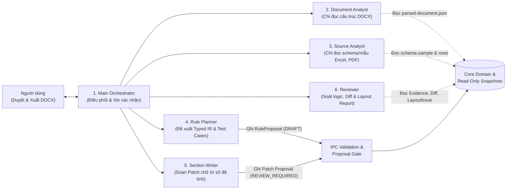

# 10 — Quy chuẩn tích hợp AI và Antigravity CLI (`agy`) trong DocFlow Studio

**Ngày biên soạn:** 25/11/2026 · **Phụ trách:** BA (`task-79ec37c0`)  
**Tài liệu căn cứ:** `docs/DOCFLOW_STUDIO_SPEC.md` (§1.2, §6.1–6.4, §9.2–9.4, §10, §11), `docs/09_KienTruc_NenTang_Va_QuyUoc_KhoiTao.md`, cùng hệ thống tài liệu kỹ thuật tùy biến Antigravity CLI (`agy`).  
**Đối tượng áp dụng:**
1. **Nhóm phát triển ứng dụng (`Dev` / `QA`):** Thiết kế lớp `app/src/adapters/ai/` tích hợp các AI CLI/SDK vào sản phẩm DocFlow Studio theo mẫu Strategy.
2. **Đội ngũ Agent phát triển repo (`ba`, `dev`, `qa` chạy trên `agy` CLI, Claude CLI, Codex CLI):** Thiết lập hàng rào bảo vệ trong `.agents/` để làm việc an toàn trên kho mã nguồn mà không bao giờ phá vỡ tính bất biến của tài liệu mẫu, nguồn dữ liệu và ảnh tham chiếu.

---

## 1. Nguyên tắc cốt lõi khi sử dụng AI trong DocFlow Studio (Spec §1.2, §6.4, §10, §11)

Mọi tích hợp AI — dù chạy qua Antigravity CLI (`agy`), Claude CLI, Codex CLI hay HTTP API — đều bị ràng buộc bởi 5 nguyên tắc bất di bất dịch sau:

1. **Phân tách trách nhiệm tuyệt đối (`Separation of Concerns`):**
   - **AI chỉ diễn giải yêu cầu tự nhiên, đề xuất kế hoạch có kiểu (Typed Rule IR), gợi ý ánh xạ nguồn và soạn thảo câu chữ nhận xét** dựa trên số liệu đã được kiểm chứng.
   - **AI KHÔNG tự nhẩm tính tiền tệ/số liệu** thay cho bộ thực thi tất định (`Sandboxed Execution Engine`).
   - **AI KHÔNG trực tiếp sửa file DOCX gốc, không cắt/ghép trang và không phán quyết số trang** thay cho `Document Composer` và `Layout Engine`.
2. **Trạng thái miền thuộc về Ứng dụng, không thuộc "trí nhớ" của LLM:**
   - Domain store (`project.sqlite`), quản lý phiên bản (`SavedRule`, `SectionRevision`), đồ thị phụ thuộc (`DependencyEdge`) và kiểm tra bố cục thuộc quyền kiểm soát của `app/src/core/`.
   - Lịch sử hội thoại chat chỉ là giao diện thu nhận yêu cầu; **cấm dùng lịch sử chat làm nơi lưu duy nhất** để tái dựng tài liệu (§11).
3. **Quyền tối thiểu theo vai trò (`Capability Scoping`):**
   - Mỗi tác nhân AI chỉ được cấp đúng tập công cụ (MCP tools / IPC capabilities) tối thiểu phục vụ nhiệm vụ của mình. Mặc định mọi phiên AI khởi chạy ở **chế độ chỉ đọc (read-only sandbox)** và **không mở mạng ngoài** trừ kênh gọi mô hình đã được cấu hình tường minh.
4. **Cấm ghi trực tiếp lên tài sản bất biến:**
   - Không một Agent nào được quyền ghi đè hoặc xóa `template/original.docx` (`Template V0`), `sources/<sourceId>/<sha256>/*` (`Source Snapshot`), hay các tài liệu đặc tả/ảnh tham chiếu (`docs/DOCFLOW_STUDIO_SPEC.md`, `docs/DocFlow_Interactive_Mockup.html`, `docs/mockup_*.png`).
   - Mọi đầu ra của AI chỉ là **Bản đề xuất (`RuleProposal` hoặc `SectionRevision` ở trạng thái `DRAFT` / `REVIEW_REQUIRED`)** ghi qua API trung gian có kiểm tra lược đồ.
5. **Con người giữ quyền phê duyệt cuối cùng (`Explicit Human Approval`):**
   - AI bị cấm gọi các lệnh `section.approveRevision`, `build.approve` và `build.exportDocx`. Khi gặp dữ liệu thiếu, đa nghĩa hoặc trùng ngày hiệu lực (§6.3), AI phải dừng và trình bày rõ tọa độ nguồn kèm các phương án để người dùng quyết định, tuyệt đối không tự bịa số.

---

## 2. Mô hình phân quyền tối thiểu (Capability Scoping) cho 6 vai trò AI (theo Spec §10)

### 2.1. Sơ đồ luồng phối hợp và ranh giới quyền hạn của 6 vai trò AI



### 2.2. Ma trận phân quyền chi tiết cho 6 vai trò AI

| STT | Vai trò AI (Spec §10) | Trách nhiệm nghiệp vụ | Quyền ĐỌC được cấp (`Read Scope`) | Quyền ĐỀ XUẤT / GHI có kiểm soát (`Write Proposal Scope`) | Hành vi & Công cụ BỊ CẤM TUYỆT ĐỐI (`Hard Deny`) |
| --- | --- | --- | --- | --- | --- |
| 1 | **`Main Orchestrator`** | Tiếp nhận yêu cầu tự nhiên của người dùng, giữ tóm tắt ngữ cảnh dự án (`Project Context`), chọn vai trò chuyên môn phù hợp, tổng hợp câu hỏi mơ hồ và xin phê duyệt trước các bước nhạy cảm. | Metadata `Project`, cây `LogicalSection`, trạng thái `STALE`/duyệt, danh mục `SavedRule`, `ExecutionPlan`, `ImpactPlan`. | Khởi tạo phiên đề xuất (`change.create` nháp khi người dùng yêu cầu), định tuyến nhiệm vụ sang 5 vai trò chuyên biệt. | Tự sửa trực tiếp file trên đĩa; tự duyệt Revision/Build; tự chạy shell bất kỳ; giữ bản sao số liệu riêng trái với `DataRegistry`. |
| 2 | **`Document Analyst`** | Phân tích cây cấu trúc OOXML đã parse, nhận diện ranh giới `LogicalSection`, bảng biểu, `startAnchor`/`endAnchor`, đánh dấu độ tin cậy (`confidence`) và cảnh báo phần tử Word phức tạp. | Chỉ đọc `template/parsed-document.json`, danh sách `DocumentBlock`, style map, bookmarks/content controls. | Trả về `SectionBoundaryProposal` và `AnchorResolutionReport` (chỉ ở dạng dữ liệu đề xuất JSON). | Ghi hoặc chạm vào `template/original.docx`; sửa `SourceArtifact`; chạy lệnh shell; tạo hay duyệt `SectionRevision`. |
| 3 | **`Source Analyst`** | Khảo sát các snapshot Excel, DOCX/PDF tham chiếu; nhận diện sheet, vùng bảng, cột khóa, kiểu ngày/tiền tệ, sheet ẩn và đề xuất `DataBinding` kèm dẫn chứng nguồn (`provenance`). | Chỉ đọc `sources/<id>/<sha256>/schema-sample.json` và đọc truy vấn phạm vi hẹp các dòng/ô trong snapshot đã ghim. | Trả về `DataBindingProposal` (nêu rõ `sourceId`, `sha256`, `sheet`, `rangeSelector`, `lookupSpec`, `unit`) và danh sách điểm mơ hồ. | Sửa file Excel/PDF nguồn; thực thi macro trong Office; tự ý chọn một dòng khi có 2 bản ghi trùng ngày hiệu lực. |
| 4 | **`Rule Planner`** | Chuyển lời mô tả nghiệp vụ thành kế hoạch thực thi có kiểu (**Typed Rule IR**: `filter` → `resolve` → `calculate` → `validate` → `rewrite`), sinh bộ `testCases` biên và liệt kê điều kiện `requiresHumanReview`. | Đọc `DataDefinition`, `DataBinding`, schema của `Section` đích, phiên bản `SavedRule` hiện tại và cấu trúc đồ thị `DependencyEdge`. | Gọi `rule.proposeFromInstruction`, `rule.validate` và kích hoạt chạy thử cô lập `rule.test` trên dữ liệu kiểm thử. | Dùng `eval()` hoặc sinh mã chạy trực tiếp trên máy chủ host ngoài sandbox; tự chuyển trạng thái Rule sang `APPROVED`; tự sửa `SectionRevision` đã duyệt. |
| 5 | **`Section Writer`** | Soạn thảo các lệnh Patch văn bản/nhận xét (`replaceText`, `insertParagraphAfter`...) dựa trên **kết quả số liệu (`outputs` + `evidence`) đã được Sandbox Executor tính xong**, bảo toàn giọng văn và cấu trúc style. | Đọc nội dung `DocumentBlock` của đúng `sectionId` được giao, kết quả `RunStep.outputs`/`evidence` đã xác thực và chính sách định dạng của Rule. | Gọi `section.saveRevision` để tạo đề xuất Patch ở trạng thái `DRAFT` hoặc `REVIEW_REQUIRED` **chỉ trong phạm vi `blockId` của Section được cấp**. | **Cấm tự tính nhẩm lại con số/tiền tệ bằng LLM** (mọi con số chèn vào câu nhận xét phải khớp tham chiếu `outputs`); cấm sửa Section khác ngoài phạm vi; cấm tự `approveRevision`. |
| 6 | **`Reviewer`** | Đối chiếu tính nhất quán giữa yêu cầu, bằng chứng tính toán (`RunStep.evidence`), `Content Diff`, `Layout Diff` và `LayoutIssue`; phát hiện mâu thuẫn số liệu hoặc lỗi trình bày trước khi người dùng duyệt. | Chỉ đọc toàn bộ `SectionRevision` nháp, `RunEvidenceBundle`, `BuildGateReport`, `LayoutInspectionReport` và diff trước/sau. | Xuất `ReviewAuditReport` (danh sách phát hiện, mức độ nghiêm trọng, gợi ý chỉnh sửa). **Không có quyền ghi thay đổi nội dung hay trạng thái.** | Sửa Rule, sửa Section, sửa file, tự duyệt hoặc tự bấm xuất DOCX. |

---

## 3. Quy chuẩn Strategy Adapter cho các AI CLI / SDK (`app/src/adapters/ai/`)

### 3.1. Giao diện Port thống nhất trong `app/src/core/ports/`

Để `core/` hoàn toàn độc lập với nhà cung cấp mô hình hay công cụ dòng lệnh (Spec §9.2), mọi bộ tích hợp AI đều phải cài đặt cùng một cổng `AiRoleAssistantPort` theo mẫu **Strategy**:

```typescript
export type AiProviderKind = 'agy-cli' | 'claude-cli' | 'codex-cli' | 'http-api';

export type AiRoleName =
  | 'main-orchestrator'
  | 'document-analyst'
  | 'source-analyst'
  | 'rule-planner'
  | 'section-writer'
  | 'reviewer';

export interface AiInvocationRequest<TInput> {
  role: AiRoleName;
  projectId: string;
  correlationId: string;
  scopedInput: TInput;                 // Chỉ truyền đúng phần dữ liệu tối thiểu mà vai trò được phép đọc
  allowedMcpTools: readonly string[];  // Danh sách trắng (allowlist) tool được phép gọi trong phiên
  timeoutMs: number;                   // Giới hạn thời gian cứng (vd: 30_000 - 120_000 ms)
  abortSignal?: AbortSignal;           // Hỗ trợ người dùng bấm Hủy (Cancel) ngay lập tức
}

export interface AiInvocationResult<TOutput> {
  provider: AiProviderKind;
  modelId: string;
  structuredOutput: TOutput;           // Đã được validate qua Zod/JSON Schema của Core
  toolCallsAudit: Array<{ toolName: string; argsHash: string; decision: 'allowed' | 'denied' }>;
  usage?: { inputTokens?: number; outputTokens?: number; durationMs: number };
}

export interface AiRoleAssistantPort {
  invokeRole<TInput, TOutput>(
    request: AiInvocationRequest<TInput>,
    outputSchema: SchemaValidator<TOutput>
  ): Promise<AiInvocationResult<TOutput>>;
}
```

### 3.2. Bảng đối chiếu cài đặt 4 Strategy Adapters

| Adapter (`app/src/adapters/ai/`) | Cơ chế gọi thực thi | Cách ép quyền tối thiểu (`Capability Scoping`) | Cách lấy kết quả có cấu trúc & Kiểm soát an toàn |
| --- | --- | --- | --- |
| **`agy-cli/`** *(Antigravity CLI & SDK)* | 1. **Chế độ CLI subprocess:** Gọi binary `agy` ở chế độ không tương tác với thư mục cấu hình phiên cô lập chứa `.agents/hooks.json` + MCP chỉ đọc.<br>2. **Chế độ Python Sidecar SDK (tùy chọn):** Dùng `google.antigravity.Agent` với `LocalAgentConfig` (mặc định chạy **read-only mode** khi không truyền `CapabilitiesConfig()` ghi). | - Mặc định tắt write tools hệ thống; chỉ gắn MCP server nội bộ của DocFlow (`docflow-scoped-mcp`) phơi bày đúng các tool trong `allowedMcpTools`.<br>- Cưỡng chế thêm bằng `PreToolUse` hook từ chối cứng mọi thao tác chạm vào đường dẫn cấm. | Yêu cầu trả JSON theo schema của vai trò; bắt luồng `tool_calls` (qua SDK hoặc transcript/hook log) để lưu `AuditEvent`; kiểm tra lại đầu ra bằng `outputSchema` trước khi trả về `core/`. |
| **`claude-cli/`** *(Claude Code CLI)* | Gọi tiến trình con `claude -p` (print/non-interactive mode) kèm cờ giới hạn công cụ và cấu hình MCP tạm thời theo phiên. | Truyền danh sách trắng công cụ (`--allowedTools` chỉ gồm các tool MCP đọc/đề xuất của vai trò đó; cấm `Bash`, `Write`, `Edit` trực tiếp trên thư mục dự án người dùng). | Bắt buộc định dạng JSON đầu ra (`--output-format json` / JSON schema), giới hạn số vòng lặp (`max-turns`) và áp `timeoutMs` + `SIGTERM/SIGKILL` khi hủy. |
| **`codex-cli/`** *(Codex CLI)* | Gọi tiến trình con `codex exec` trong môi trường hộp cát chỉ đọc (`--sandbox read-only`), truyền ngữ cảnh đầu vào qua stdin/file tạm chỉ đọc. | Đặt chế độ sandbox cấp hệ điều hành là `read-only`; chỉ mở giao tiếp qua MCP server nội bộ có kiểm tra quyền theo token phiên (`sessionCapabilityToken`). | Đọc kết quả có cấu trúc từ đầu ra chuẩn, kiểm tra schema nghiêm ngặt; nếu đầu ra chứa đề xuất ngoài phạm vi `sectionId` thì từ chối với lỗi `PATCH_OUT_OF_SECTION_SCOPE`. |
| **`api/`** *(Direct Model HTTP API)* | Gọi trực tiếp HTTPS tới endpoint mô hình được cấu hình, truyền `tools` (function declarations) tương ứng với `allowedMcpTools`. | Không có quyền truy cập shell hay filesystem máy trạm; mọi `tool_call` do mô hình phát ra đều được thực thi ngay trong bộ định tuyến có kiểm quyền của `app/`. | Sử dụng chế độ `response_schema` (Structured Outputs); yêu cầu bật cờ đồng ý gửi dữ liệu ra mạng ngoài theo từng dự án (cảnh báo bảo mật dữ liệu doanh nghiệp). |

### 3.3. Quy tắc vận hành an toàn chung cho mọi CLI Adapter

1. **Không truyền đường dẫn kho gốc nhạy cảm nếu không cần thiết:** Thay vì cho CLI quét tự do toàn bộ ổ đĩa của người dùng, Adapter chỉ cung cấp dữ liệu đã trích xuất gọn (`scopedInput`) hoặc kết nối qua MCP chỉ đọc của DocFlow.
2. **Bảo vệ dữ liệu khi chạy Offline-first:** Tính năng gọi AI phải có công tắc bật/tắt rõ ràng theo từng dự án. Khi ở chế độ Offline hoàn toàn, người dùng vẫn định nghĩa/chỉnh sửa Rule IR, chạy DAG Runner, duyệt Revision và xuất DOCX bình thường mà không phụ thuộc bất kỳ AI Adapter nào.
3. **Quản lý tiến trình con chặt chẽ:** Mọi lời gọi CLI chạy qua `spawn` (không dùng `exec` nối chuỗi shell để tránh Command Injection), có truyền môi trường sạch (lọc bỏ biến môi trường nhạy cảm không liên quan), có `timeoutMs` cứng và tự động dọn sạch nhóm tiến trình con khi người dùng bấm Hủy hoặc đóng cửa sổ ứng dụng.

---

## 4. Cấu trúc tùy biến và Hàng rào bảo vệ trong `.agents/` cho Antigravity CLI (`agy`)

Antigravity CLI (`agy`) tự động khám phá cấu hình từ thư mục làm việc hiện tại ngược lên gốc repo theo thứ tự ưu tiên từ cao xuống thấp:
1. **Workspace Project (`.agents/`, `AGENTS.md`, `GEMINI.md` theo phân cấp thư mục)**
2. **Declared Configurations (`.agents/skills.json`, `.agents/plugins.json`)**
3. **Global Discovery (`~/.gemini/config/`)**
4. **Built-in Customizations**
5. **Global Declared Configurations**

*(Lưu ý: Cấu hình vận hành cấp máy trạm của riêng CLI đặt tại `~/.gemini/antigravity-cli/settings.json`; tuyệt đối không đưa khóa bí mật cá nhân vào repo).*

### 4.1. Cây thư mục chuẩn của `.agents/` trong dự án DocFlow Studio

```text
docflow-studio/
  AGENTS.md                                   # Quy tắc luôn bật ở gốc repo (< 24KB): bất biến V0/docs, ranh giới 4 lớp, tiếng Việt
  app/
    src/
      core/
        AGENTS.md                             # Quy tắc riêng cho core/: cấm import electron, react, fs, sqlite, child_process
  .agents/
    hooks.json                                # Lifecycle hooks cưỡng chế an toàn (PreToolUse, PostToolUse, SessionStart)
    skills.json                               # Khai báo đường dẫn chia sẻ skills cho cả nhóm qua Git (nếu dùng thư mục chung)
    plugins.json                              # Khai báo các plugin nội bộ được kích hoạt trong workspace
    scripts/
      guard-immutable-paths.mjs               # Script kiểm tra PreToolUse chặn ghi đè Template V0, Sources, Spec & Mockup
      verify-post-tool-integrity.mjs          # Script kiểm tra PostToolUse xác thực JSON schema & sha256 bất biến
    skills/                                   # Các kỹ năng chuyên biệt tải theo cơ chế Progressive Disclosure
      desktop-ports-architecture/
        SKILL.md
        references/                           # Tài liệu chi tiết tách riêng để tiết kiệm context window
      immutable-docx-patching/
        SKILL.md
      typed-rule-and-provenance/
        SKILL.md
      dag-incremental-runner/
        SKILL.md
      agy-cli-integration/
        SKILL.md
      prototype-conventions/
        SKILL.md
      dependency-and-approval-contract/
        SKILL.md
      prototype-browser-verification/
        SKILL.md
    plugins/
      docflow-guard/                          # Native plugin đóng gói đồng bộ Rules + Skills + Hooks + MCP chỉ đọc
        plugin.json
        hooks.json                            # LƯU Ý BẮT BUỘC: Đặt ngay tại gốc thư mục native plugin (<plugin_dir>/hooks.json)
        mcp_config.json                       # Cấu hình MCP chỉ đọc mặc định
        rules/
          AGENTS.md
        skills/
```

### 4.2. Quy chuẩn thiết kế Rules (`AGENTS.md` / `GEMINI.md`) và Skills (*Progressive Disclosure*)

1. **Workspace Rules (`AGENTS.md` / `GEMINI.md`):**
   - Đặt trực tiếp tại gốc repo và các thư mục con trọng yếu (như `app/src/core/AGENTS.md`, `docs/AGENTS.md`).
   - File `AGENTS.md` / `GEMINI.md` độc lập **không dùng YAML frontmatter** và luôn được nạp tự động cho phạm vi thư mục đó.
   - **Giới hạn dung lượng bắt buộc:** Mỗi file rule phải nhỏ hơn **`24 KB` (`24.000` bytes)** sau khi mở rộng liên kết; tổng ngân sách rules luôn bật toàn phiên giữ dưới **`20.000` tokens** để không bị hạ cấp thành con trỏ đường dẫn.
   - Nội dung chỉ ghi các ràng buộc cứng không đổi: cấm sửa `docs/DOCFLOW_STUDIO_SPEC.md`, `docs/DocFlow_Interactive_Mockup.html`, `docs/mockup_*.png`, cấm ghi đè `template/original.docx` và `sources/`, quy tắc chiều phụ thuộc `ui → core ← adapters/infra`, chuẩn ngôn ngữ tiếng Việt.
2. **Workspace Skills (`.agents/skills/<ten-skill>/SKILL.md`):**
   - Áp dụng triệt để nguyên lý **Progressive Disclosure**: Mặc định `agy` chỉ nạp `name` và `description` trong YAML frontmatter vào ngữ cảnh; toàn bộ nội dung `SKILL.md` chỉ được nạp khi tác vụ thực sự kích hoạt skill.
   - Yêu cầu định dạng:
     - `name`: Chữ thường nối bằng dấu gạch ngang (ví dụ `immutable-docx-patching`).
     - `description`: Viết ngôi thứ ba, nêu rõ **kỹ năng làm gì** và **khi nào agent phải đọc nó**.
     - Giữ `SKILL.md` ngắn gọn (dưới ~100–150 dòng quy trình cốt lõi); đưa bảng tra cứu lớn, schema mẫu hoặc tài liệu chi tiết sang thư mục con `references/` và các công cụ kiểm tra sang `scripts/`.
3. **Chia sẻ nhóm qua VCS (`.agents/skills.json` & `.agents/plugins.json`):**
   - Dùng đường dẫn tương đối theo gốc workspace (không bắt đầu bằng `/` hay `~/`) trong `entries` để mọi thành viên hoặc agent worktree khi clone repo đều tự động nhận diện đồng nhất.
   - Với native plugin trong `.agents/plugins/<plugin_name>/` (có `plugin.json`), file `hooks.json` **phải đặt trực tiếp ở gốc thư mục plugin** (`<plugin_dir>/hooks.json`), không đặt lồng trong thư mục con `hooks/hooks.json`.

---

## 5. Đặc tả chi tiết Lifecycle Hooks bảo vệ tài sản bất biến (`.agents/hooks.json`)

Lifecycle hooks trong `agy` là chốt chặn kỹ thuật cấp hệ thống (chạy đồng bộ qua lệnh shell, nhận JSON trên `stdin` và trả JSON trên `stdout` với **tất cả khóa ở dạng `camelCase`**) nhằm đảm bảo ngay cả khi mô hình AI suy luận sai cũng không thể phá hỏng file mẫu, nguồn dữ liệu hay tài liệu gốc.

### 5.1. Danh sách đường dẫn được bảo vệ cứng (`Protected Immutable Paths`)

Mọi công cụ có khả năng ghi/xóa/chạy lệnh (`write_file`, `edit_file`, `run_command`, hoặc MCP write tools) đều phải đi qua bộ lọc kiểm tra các mẫu đường dẫn bất biến sau:

1. **Tài sản đặc tả & giao diện gốc trong repo:**
   - `docs/DOCFLOW_STUDIO_SPEC.md`
   - `docs/DocFlow_Interactive_Mockup.html`
   - `docs/mockup_01_workspace.png`, `docs/mockup_02_recipe.png`, `docs/mockup_03_runner.png`, `docs/mockup_04_build.png`
2. **Tài sản dự án người dùng và mẫu kiểm thử:**
   - `**/template/original.docx` và `**/template/template-sha256.txt`
   - `**/sources/*/*/*` (mọi snapshot nguồn đã lưu theo `sha256`)
   - `corpus/**` (bộ tài liệu DOCX/Excel mẫu thật dùng để đo kiểm ở Phase 0 — chỉ đọc)
3. **Các bản ghi lịch sử bất biến đã chốt:**
   - `**/builds/*/manifest.json` và `**/builds/*/output.docx` đã tồn tại (ngăn ghi đè bản build cũ; muốn sửa phải tạo bản dựng hoặc nhánh mới).

### 5.2. Cấu hình chuẩn `.agents/hooks.json`

```json
{
  "docflow-immutable-guard": {
    "enabled": true,
    "SessionStart": [
      {
        "type": "command",
        "command": "node ./scripts/session-context.mjs",
        "timeout": 5
      }
    ],
    "PreToolUse": [
      {
        "matcher": "write_file|edit_file|delete_file|run_command|call_mcp_tool",
        "hooks": [
          {
            "type": "command",
            "command": "node ./scripts/guard-immutable-paths.mjs",
            "timeout": 10
          }
        ]
      }
    ],
    "PostToolUse": [
      {
        "matcher": "write_file|edit_file|run_command",
        "hooks": [
          {
            "type": "command",
            "command": "node ./scripts/verify-post-tool-integrity.mjs",
            "timeout": 15
          }
        ]
      }
    ]
  }
}
```

*(Ghi chú: Thư mục làm việc của tiến trình chạy hook mặc định là thư mục chứa `hooks.json` — tức `.agents/`; trong payload `stdin`, trường `cwd` cho biết thư mục làm việc hiện tại của agent và `workspacePaths` liệt kê đường dẫn gốc của workspace).*

### 5.3. Hợp đồng xử lý chi tiết của Hook `PreToolUse`

#### A. Dữ liệu đầu vào (`stdin` — `camelCase`)
Khi agent chuẩn bị gọi một công cụ khớp `matcher`, `agy` gửi JSON tới `stdin` của `guard-immutable-paths.mjs`:

```json
{
  "conversationId": "0bbc7f59-2053-4ecf-93e4-aaef77dc6dd7",
  "workspacePaths": ["/Users/khanhnm/Desktop/project/docflow-studio"],
  "modelName": "auto",
  "lastUserInput": "Cập nhật kết quả doanh thu vào tài liệu",
  "hookEventName": "PreToolUse",
  "cwd": "/Users/khanhnm/Desktop/project/docflow-studio",
  "stepIdx": 12,
  "toolCall": {
    "id": "toolu_01",
    "name": "write_file",
    "args": {
      "Path": "/path/to/project/template/original.docx",
      "Content": "...",
      "Overwrite": true
    }
  }
}
```

#### B. Quy tắc phán quyết và Đầu ra (`stdout` — `camelCase`)

Script bảo vệ chuẩn hóa đường dẫn tuyệt đối (`realpath` / `path.resolve` dựa trên `cwd` và `workspacePaths`) rồi trả về đúng một trong các quyết định sau:

1. **Chặn cứng (`"decision": "deny"`) — Không cho phép vượt rào:**
   - Khi `write_file` / `edit_file` / `delete_file` nhắm tới bất kỳ đường dẫn nào thuộc danh sách **Protected Immutable Paths** ở mục §5.1.
   - Khi `run_command` chứa thao tác ghi/xóa/đổi tên/đổi quyền (`>`, `>>`, `tee`, `cp`, `mv`, `rm`, `sed -i`, `perl -pi`, `chmod`, `dd`, `python/node -e` ghi file...) chạm tới các đường dẫn bất biến trên, hoặc cố tình sửa `.agents/hooks.json` / `.agents/scripts/*` để vô hiệu hóa hàng rào an toàn.
   - Khi agent đang chạy dưới vai trò hạn chế (qua biến môi trường phiên `DOCFLOW_AI_ROLE=document-analyst|source-analyst|reviewer`) mà gọi bất kỳ công cụ ghi file hoặc chạy lệnh hệ thống nào.
   - **Mẫu JSON trả về trên `stdout`:**
     ```json
     {
       "decision": "deny",
       "reason": "VI PHẠM NGUYÊN TẮC BẤT BIẾN: Không được phép sửa hoặc ghi đè Template V0, Source Snapshot, đặc tả gốc hoặc file Prototype tham chiếu."
     }
     ```

2. **Buộc hỏi xác nhận người dùng (`"decision": "force_ask"` hoặc `"ask"`):**
   - Áp dụng cho thao tác nhạy cảm nhưng hợp lệ trong quá trình phát triển (ví dụ: cài đặt gói phụ thuộc mới trong `app/package.json`, xóa dọn vùng tạm ngoài `working/`, hoặc chạy lệnh cần vượt sandbox mạng `BypassSandbox: true`).
   - Dùng `"force_ask"` (luôn hỏi lại, bỏ qua bộ nhớ đệm "Always Allow") đối với các lệnh có cờ xóa đệ quy (`rm -rf`) hoặc thay đổi cấu trúc migration SQLite đã phát hành.
   - **Mẫu JSON trả về trên `stdout`:**
     ```json
     {
       "decision": "force_ask",
       "reason": "Thao tác nhạy cảm ảnh hưởng cấu hình gói hoặc schema dữ liệu — cần người dùng xác nhận trực tiếp."
     }
     ```

3. **Cho phép tự động (`"decision": "allow"`):**
   - Khi thao tác nằm gọn trong vùng được phép của vai trò hiện tại (ví dụ: Dev sửa mã trong `app/src/**`, QA thêm kiểm thử trong `app/tests/**`, BA ghi tài liệu mới được giao trong `docs/09_*.md`, hoặc Section Writer ghi đề xuất nháp qua MCP được kiểm soát).
   - **Mẫu JSON trả về trên `stdout`:**
     ```json
     {
       "decision": "allow"
     }
     ```

### 5.4. Hợp đồng của `PostToolUse` và `SessionStart`

- **`PostToolUse` (`verify-post-tool-integrity.mjs`):**
  - Chạy ngay sau khi `write_file`, `edit_file` hoặc `run_command` hoàn tất; kiểm tra nhanh mã băm `sha256` của các file gốc bảo vệ (đảm bảo không bị thay đổi gián tiếp qua script phụ) và kiểm tra cú pháp JSON/ranh giới import (`core/` không dính `electron`/`fs`).
  - Theo đúng hợp đồng của `agy`, script kết thúc thành công và xuất ra đối tượng JSON rỗng trên `stdout`: `{}`.
- **`SessionStart` (`session-context.mjs`):**
  - Khi bắt đầu phiên làm việc, tiêm nhắc nhở ngắn gọn về vai trò hiện tại và trạng thái khóa bất biến thông qua trường `injectSteps`:
    ```json
    {
      "injectSteps": [
        {
          "systemMessage": {
            "systemMessage": "Chế độ bảo vệ DocFlow Studio đang bật: Template V0, Source Snapshots, DOCFLOW_STUDIO_SPEC.md, DocFlow_Interactive_Mockup.html và mockup_*.png là bất biến (chỉ đọc)."
          }
        }
      ]
    }
    ```

---

## 6. Cấu hình MCP Server chỉ đọc mặc định (`mcp_config.json`)

Để các vai trò AI truy vấn dữ liệu dự án an toàn mà không cần mở quyền đọc/ghi hệ thống tệp thô hay chạy câu lệnh SQL tùy ý, DocFlow Studio chuẩn hóa giao tiếp công cụ qua **Model Context Protocol (MCP)**:

### 6.1. Quy tắc giao thức và cấu hình

1. **Chỉ dùng 2 cơ chế truyền tải chuẩn được `agy` hỗ trợ:**
   - **Stdio (`command`, `args`, `env`):** Ưu tiên số một cho ứng dụng desktop offline-first; chạy tiến trình MCP nội bộ ngay trên máy người dùng mà không mở cổng mạng.
   - **Streamable HTTP (`url` trỏ tới `/mcp`):** Chỉ dùng khi kết nối dịch vụ doanh nghiệp từ xa được phê duyệt; **không dùng giao thức HTTP+SSE cũ (`/sse`)**.
2. **Mặc định Chỉ Đọc (`Read-Only by Default`):**
   - Mọi kết nối tới `project.sqlite` và kho `template/` + `sources/` qua MCP phải truyền biến môi trường khóa cứng chế độ chỉ đọc (`DOCFLOW_MCP_MODE=READONLY`, mở SQLite với cờ `readonly: true`).
   - Các công cụ đề xuất thay đổi (`propose_rule_ir`, `propose_section_patch`) đi qua một MCP server tách riêng chỉ cho phép ghi vào bảng/thư mục **Proposal nháp**, kèm kiểm tra `DOCFLOW_AI_ROLE` trước khi thực hiện.

### 6.2. Mẫu cấu hình `mcp_config.json` chuẩn (đặt trong `.agents/plugins/docflow-guard/mcp_config.json`)

```json
{
  "mcpServers": {
    "docflow-project-readonly": {
      "command": "node",
      "args": ["./mcp/docflow-readonly-server.mjs"],
      "env": {
        "DOCFLOW_MCP_MODE": "READONLY",
        "SQLITE_OPEN_READONLY": "true",
        "ALLOW_EXTERNAL_NETWORK": "false"
      }
    },
    "docflow-proposal-gateway": {
      "command": "node",
      "args": ["./mcp/docflow-proposal-server.mjs"],
      "env": {
        "DOCFLOW_PROPOSAL_ONLY": "true",
        "DENY_APPROVAL_AND_EXPORT": "true"
      }
    }
  }
}
```

### 6.3. Phân bổ công cụ MCP theo đúng vai trò AI

| Tên công cụ MCP | Server cung cấp | Vai trò AI được phép gọi | Chức năng & Giới hạn an toàn |
| --- | --- | --- | --- |
| `get_parsed_document_tree` | `docflow-project-readonly` | `Document Analyst`, `Section Writer`, `Reviewer` | Đọc cấu trúc `DocumentBlock`, styles, anchors từ `parsed-document.json` (không chạm file gốc). |
| `inspect_source_schema` | `docflow-project-readonly` | `Source Analyst`, `Rule Planner`, `Reviewer` | Đọc danh sách sheet, cột, kiểu dữ liệu, đơn vị và `sha256` của `SourceArtifact`. |
| `query_source_rows_preview` | `docflow-project-readonly` | `Source Analyst`, `Rule Planner` | Xem mẫu các dòng dữ liệu giới hạn số lượng kèm tọa độ dòng/cột để lập `DataBinding` và phát hiện trùng lặp. |
| `get_dependency_and_run_evidence` | `docflow-project-readonly` | `Main Orchestrator`, `Section Writer`, `Reviewer` | Đọc đồ thị DAG, trạng thái `STALE`, kết quả tính toán và `RunStep.evidence` đã xác thực. |
| `get_diff_and_layout_report` | `docflow-project-readonly` | `Reviewer`, `Main Orchestrator` | Đọc `Content Diff`, `Layout Diff` và danh sách `LayoutIssue` của bản dựng xem trước. |
| `propose_rule_draft` | `docflow-proposal-gateway` | **Chỉ `Rule Planner`** | Kiểm tra lược đồ Typed IR, phát hiện chu trình DAG và lưu bản nháp `SavedRule` (`DRAFT`) kèm `testCases`. |
| `run_rule_sandbox_test` | `docflow-proposal-gateway` | `Rule Planner`, `Reviewer` | Chạy thử Rule IR trong sandbox tất định chỉ đọc, trả về kết quả và bằng chứng mà không sửa trạng thái chính thức. |
| `propose_section_patch` | `docflow-proposal-gateway` | **Chỉ `Section Writer`** | Lưu đề xuất `SectionRevision` (`REVIEW_REQUIRED`) trong đúng phạm vi `sectionId` được cấp; kiểm tra mọi con số trong câu chữ khớp với `RunStep.outputs`. |

---

## 7. Danh sách kiểm tra nghiệm thu (Checklist) cho Dev & QA đối với tích hợp AI / `agy` CLI

1. **Kiểm chứng quyền đọc/ghi tối thiểu của `agy` CLI:**
   - [ ] Khởi chạy Adapter `agy` (hoặc SDK `LocalAgentConfig` mặc định) xác nhận các công cụ ghi file hệ thống trực tiếp bị tắt hoặc bị chặn bởi `PreToolUse`.
   - [ ] Thử giả lập lệnh AI gọi `write_file`, `edit_file` hoặc `run_command` nhắm vào `template/original.docx`, `sources/<id>/<sha256>/source.xlsx`, `docs/DOCFLOW_STUDIO_SPEC.md`, `docs/DocFlow_Interactive_Mockup.html` và `docs/mockup_*.png` → Hook `PreToolUse` phải trả về `{"decision": "deny"}` ở 100% trường hợp.
2. **Kiểm chứng phân tách vai trò AI (§10):**
   - [ ] `Section Writer` không thể tự thay đổi con số kết quả khác với `RunStep.outputs` và không thể ghi Patch ra ngoài `sectionId` được giao (`PATCH_OUT_OF_SECTION_SCOPE`).
   - [ ] Không vai trò AI nào gọi được `section.approveRevision`, `build.approve` hoặc `build.exportDocx` (`CAPABILITY_DENIED`).
   - [ ] Khi dữ liệu nguồn thiếu hoặc trùng ngày hiệu lực, `Source Analyst` / `Rule Planner` báo rõ tọa độ mơ hồ (`SOURCE_LOOKUP_AMBIGUOUS` / `SOURCE_DATA_MISSING`), không tự chọn bừa bản ghi.
3. **Kiểm chứng khả năng vận hành độc lập không phụ thuộc lịch sử chat (§11):**
   - [ ] Xóa toàn bộ phiên hội thoại chat của AI, đóng và mở lại dự án → Toàn bộ `SavedRule`, `DataBinding`, `SectionRevision`, `Run` và `BuildManifest` trong `project.sqlite` + thư mục dự án vẫn tái chạy và tái dựng DOCX bình thường 100%.
