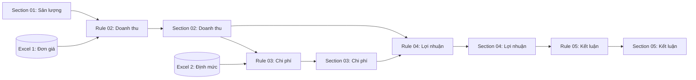
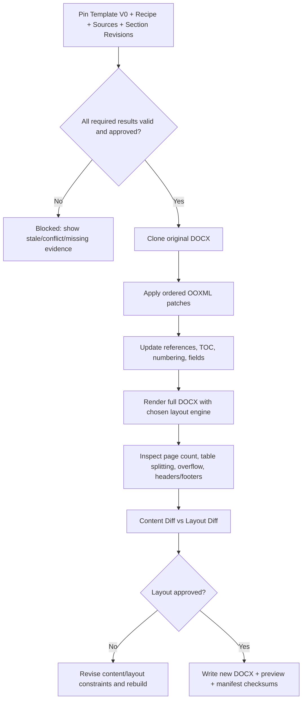
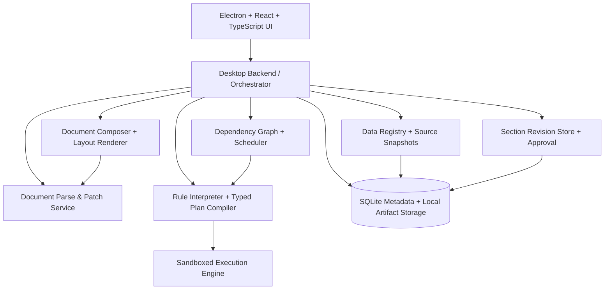

# DOCFLOW STUDIO — PRODUCT & TECHNICAL SPECIFICATION

**Tên sản phẩm (đề xuất):** DocFlow Studio  
**Định vị:** Document Recipe & Rebuild — hệ thống tạo, chỉnh sửa, tái tính toán và xuất tài liệu DOCX từ một mẫu bất biến.  
**Phiên bản đặc tả:** 1.0 (bản thiết kế đề xuất)  
**Ngày:** 22/11/2026  
**Trạng thái:** Concept / implementation blueprint; mockup chưa tích hợp xử lý DOCX thực.

> **Mục tiêu cốt lõi:** Người dùng cung cấp một DOCX mẫu và các nguồn bổ trợ (Excel, DOCX, PDF...). Người dùng yêu cầu thay đổi một phần, mô tả cách tham chiếu hoặc tính toán bằng ngôn ngữ tự nhiên, lưu các quy tắc và quan hệ ảnh hưởng thành **Document Recipe có phiên bản**. Các lần sau chỉ thay một số, đổi một file hoặc sửa một phần; hệ thống xác định cần chạy lại một phần, các phần phụ thuộc hay toàn bộ, cho xem và duyệt kết quả rồi xuất **DOCX hoàn chỉnh**. File mẫu **không bao giờ bị ghi đè**.

---

## 1. Phạm vi và nguyên tắc thiết kế

### 1.1. Phạm vi chức năng

1. Import DOCX mẫu bất biến; đọc cấu trúc, mục, đoạn, bảng, hình ảnh, header/footer, bookmark, style, page/section break.
2. Nhập Excel, DOCX/PDF tham chiếu, tài liệu nghiệp vụ; hiển thị provenance (nguồn gốc) và tạo snapshot của từng nguồn.
3. Nhận diện/cho chỉnh sửa **Logical Section** của tài liệu, độc lập vị trí trang.
4. Chọn phần và yêu cầu sửa bằng ngôn ngữ tự nhiên; hỗ trợ sửa giá trị, sửa văn bản, thay bảng, thêm/bớt đoạn.
5. Định nghĩa **Saved Rule** gồm: cách lấy dữ liệu, cách chọn bản ghi, thời điểm hiệu lực, công thức, ngoại lệ, cách viết lại nhận xét và điều kiện kiểm tra.
6. Tạo **Data Binding** từ giá trị trong Section tới dữ liệu Excel/file nguồn; cho phép người dùng chỉ vùng và xem căn cứ chọn.
7. Xây **Dependency Graph** giữa giá trị, Rule, Section và nguồn dữ liệu; tự đánh dấu kết quả cũ (*stale*).
8. Chạy **một Rule/Section**, **các phần bị ảnh hưởng**, hoặc **toàn bộ Recipe**; lưu kết quả và log từng bước.
9. Duyệt theo phần và theo bản build; xem trước-sau, số liệu trung gian, đối chiếu nguồn và lịch sử sửa.
10. Dựng lại DOCX trên bản sao mẫu, tính lại layout toàn tài liệu, phát hiện vấn đề khi phần dài ra/ngắn lại.
11. Lưu các **Build Snapshot** tái lập được; xuất DOCX và (sau) PDF.

### 1.2. Các nguyên tắc không được vi phạm

- **Immutable template:** DOCX mẫu lưu content hash và bản gốc chỉ đọc. Mọi thay đổi là Patch/Revision trên bản làm việc.
- **Section != page:** Section logic là đơn vị nghiệp vụ, không phải trang; trang chỉ được xác định sau khi render toàn bộ.
- **Single source of truth:** Dữ liệu có ID, đơn vị, nguồn, quy tắc và phiên bản. Không để các Agent giữ bản sao dữ liệu “đúng” riêng biệt.
- **Separation of concerns:** AI diễn giải/soạn nội dung; executor xác định thực hiện phép tính; composer chỉnh sửa DOCX; layout engine phân trang.
- **Reproducible builds:** Build lưu ID/hash template, dữ liệu, rule, executor, section revisions và settings dựng tài liệu.
- **Explicit approval:** Bản nháp tính toán không tự động thay thế bản đã duyệt. Khi đầu vào đổi, bản đã duyệt cũ được giữ để tra cứu nhưng **không còn hợp lệ cho build mới**.
- **Auditable results:** Từng số liệu quan trọng có thể truy ra nguồn/cell/bản ghi, điều kiện chọn, bước tính và phiên bản.
- **Safe defaults:** Thiếu dữ liệu, đa nghĩa, trùng bản ghi hiệu lực, nguồn mâu thuẫn → dừng hoặc yêu cầu duyệt; không tự bịa số.

### 1.3. Không nằm trong MVP

- Cộng tác thời gian thực nhiều người cùng sửa trên cùng một DOCX.
- Đảm bảo xuất pixel-identical cho tất cả phiên bản Word, font và hệ điều hành.
- Tùy tiện chỉnh sửa mọi đối tượng Word nâng cao như macro, biểu đồ OLE, equation phức tạp.
- Để AI tự thực thi code bất kỳ không kiểm soát hoặc tự sửa file nguồn Excel gốc.

---

## 2. Hành trình người dùng từ đầu đến cuối

### 2.1. Tạo dự án lần đầu

1. Tạo Project → thêm `Mau-bao-cao.docx` → chốt `Template V0` với hash không đổi.
2. Parse DOCX thành các logical section, paragraph/block/table và anchor. Người dùng duyệt/chỉnh ranh giới Section.
3. Thêm `Excel 1`, `Excel 2`, tài liệu tham chiếu; đánh dấu sheet, vùng, cột khóa, phiên bản snapshot.
4. Người dùng chọn Section 01, sửa sản lượng `12.000 → 15.000`, lưu **Change Request CR-001**.
5. Hệ thống ghi Data Revision `production.quantity=15000`; đánh dấu các Rule/Section phụ thuộc `STALE`.
6. Chọn Section 02 và mô tả: “Lấy sản lượng từ phần 1, tra đơn giá sản phẩm trong Excel 1, lấy mức giá hiệu lực ở ngày lập kế hoạch, tính doanh thu; sửa bảng và đoạn nhận xét.”
7. Rule Studio tạo **proposal**: inputs, lookup filters, steps, output, expected evidence; người dùng chọn/duyệt mapping và các ngoại lệ.
8. Chạy thử trên snapshot file, xem `15.000 × 250.000 = 3.750.000.000 đ`, kiểm tra dòng Excel đã dùng và các giá trị trung gian.
9. Lưu **Saved Rule** có version, Section Revision tương ứng; duyệt kết quả. Tiếp tục Section 03/04/05 qua quan hệ phụ thuộc.
10. Build full preview → phát hiện layout shift, kiểm tra hình/bảng/mục lục/số trang, duyệt → xuất bản DOCX mới.

### 2.2. Từ lần thứ hai trở đi

1. Mở Project cùng Recipe; chọn `production.quantity=18000` hoặc thay snapshot Excel.
2. App so sánh input fingerprints → xác định chính xác Rule/Section không còn hợp lệ.
3. Người dùng chọn phạm vi tính lại: một Section, các node bị ảnh hưởng, hoặc toàn bộ Recipe.
4. App tính theo thứ tự topological, có thể dùng cache cho node không đổi đầu vào+rule+executor.
5. Xem diff nội dung, bảng số liệu, evidence, xác nhận lỗi dữ liệu và duyệt Revision mới.
6. Build toàn bộ DOCX từ Template V0 + revisions hợp lệ; layout engine tự phân trang lại.
7. So sánh bản gốc với bản mới theo **Content Diff** và **Layout Diff**, lưu Build Snapshot và xuất.

---

## 3. Luồng vòng đời và trạng thái

### 3.1. Các trạng thái nên tách riêng

| Đối tượng | Trạng thái ví dụ | Ý nghĩa |
| --- | --- | --- |
| Rule | DRAFT, VALIDATED, APPROVED, DEPRECATED | Quy tắc nghiệp vụ có thể dùng lại hay chưa |
| Input/Binding | READY, MISSING, AMBIGUOUS, CHANGED | Dữ liệu nguồn có thể sử dụng và có đổi không |
| Calculation Result | NOT_RUN, STALE, RUNNING, FAILED, RESULT_READY, APPROVED | Trạng thái kết quả, **không** phải trạng thái bố cục |
| Section Revision | DRAFT, REVIEW_REQUIRED, APPROVED, SUPERSEDED | Nội dung đề xuất và duyệt |
| Document Build | BLOCKED, BUILDING, RENDERED, LAYOUT_REVIEW, APPROVED, EXPORTED | Vòng đời bản tài liệu hoàn chỉnh |
| Layout Difference | SHIFTED, SPLIT_CHANGED, OVERFLOW, EMPTY_PAGE, NO_CHANGE | Thay đổi vị trí khác với thay đổi nội dung |

### 3.2. Quy tắc invalidation

- Khi dữ liệu/Rule phụ thuộc thay đổi, chỉ số liệu/Section phụ thuộc bị đánh dấu `STALE`, không xóa Revision cũ.
- Nếu chạy **chỉ Section 02**, Section 03–05 vẫn là `STALE`; build phải bị chặn nếu những phần đó bắt buộc cần đồng bộ.
- Nếu muốn chạy Section 03 nhưng Section 02 đầu vào đã `STALE`, UI phải yêu cầu chạy phần upstream hoặc báo rõ kết quả đang sử dụng dữ liệu cũ.
- Khi Rule được sửa, không áp dụng bí mật vào Revision đã duyệt; tạo Rule Version và invalidation liên quan.
- Nếu kết quả đầu ra được tính lại nhưng hash/giá trị thực tế **không đổi**, tránh tạo diff nội dung không cần thiết; vẫn giữ bản ghi lần chạy và provenance mới.
- Nếu có vòng phụ thuộc (A → B → A), phát hiện ở thời điểm lưu Rule và yêu cầu thiết kế cơ chế lặp có điểm dừng hoặc phá vòng.

---

## 4. Các màn hình cần xây (UX/IA)

### 4.1. Workspace — trung tâm chỉnh sửa Section

**Bố cục 3 vùng:**

- Trái: file mẫu, Excel, cây Section, biểu tượng trạng thái, phiên bản mới nhất.
- Giữa: Full Document Preview hoặc Section Preview; thao tác chọn khối, xem trước/sau, highlight giá trị/đoạn bị đổi.
- Phải: yêu cầu chỉnh sửa, dữ liệu đang dùng, Rule gắn với phần, các phần bị ảnh hưởng, nút **Lưu bản nháp / Chạy / Duyệt**.

Ở cuối màn hình có một **Change Tray** hiển thị các yêu cầu đã lưu, patch tạm, số lỗi, nút mở diff.

### 4.2. Recipe Studio — định nghĩa lâu dài

- Danh sách Rule có `ruleId`, version, status, target.
- Biên tập mô tả nghiệp vụ bằng lời (vùng text lớn).
- Tab `AI diễn giải`: các bước lọc/tra cứu/join/chọn bản ghi/tính/diễn giải.
- Tab `Nguồn`: Excel, sheet, ranges, khóa join, tham số thời điểm và mức ưu tiên.
- Tab `Công thức`: biểu thức/AST/workflow có kiểu dữ liệu; hiển thị mã chỉ đọc/chỉnh sửa theo quyền.
- Tab `Kiểm thử`: tập ca kiểm thử và kết quả chạy + provenance.
- Tab `Quan hệ`: upstream/downstream Section và Rule.
- Phân biệt lưu **One-time Patch** và lưu thành **Reusable Rule**.

### 4.3. Dependency & Runner

- Đồ thị node loại: SOURCE, VALUE, RULE, SECTION, BUILD; edge theo loại `USES`, `PRODUCES`, `REFERENCES`, `REWRITES`.
- Color/state: green = ready; amber = stale; red = failed; neutral = unchanged.
- 3 phạm vi: `Selected Section`, `Affected Transitive Closure`, `Full Recipe`.
- Trước khi chạy hiển thị *execution plan*: node chạy, node dùng cache, node bị chặn, nguồn thiếu.
- Sau khi chạy: bảng kết quả từng phần, evidence, runtime logs, exception, trạng thái duyệt.

### 4.4. Build & Preview

- Trái: manifest của bản build (Template/Recipe/Source Snapshot/Section Revisions).
- Giữa: các trang PDF/ảnh render từ **DOCX sau khi áp Patch**, thumbnails + full preview.
- Phải: kiểm tra số trang, bảng tách, header/footer, heading, TOC, page numbers và danh sách cảnh báo.
- Tab `Content Diff` khác `Layout Diff`; Layout Diff chỉ ra Section nào bị dịch trang mà không bị sửa chữ.
- Chỉ bật `Xuất DOCX` khi dữ liệu & các Revision đã đạt tiêu chuẩn, hoặc có cơ chế override được ghi nhận và có quyền rõ ràng.

### 4.5. History & Versions

- Timeline: thay giá trị, lưu Rule, chạy Rule, phê duyệt Section, build preview, xuất DOCX.
- Có thể mở Build Snapshot cũ, xem input fingerprints, file version, rule version, page count, diff và tái dựng lại.
- Cho chọn một Build Snapshot để tạo nhánh chỉnh sửa mới thay vì ghi đè build cũ.

---

## 5. Mô hình dữ liệu miền (domain model)

| Entity | Các trường tối thiểu | Ghi chú |
| --- | --- | --- |
| Project | id, title, status, currentRecipeVersion | Một không gian làm việc |
| TemplateArtifact | id, path, sha256, parsedAt, OOXML map | Chỉ đọc |
| SourceArtifact | id, type, path, version, sha256, importedAt | Excel, PDF, DOCX... |
| LogicalSection | id, parentId, title, order, startAnchor, endAnchor | Không lưu số trang là identity |
| DocumentBlock | id, sectionId, ooxmlLocator, type, styleRef, anchorFingerprint | Đoạn/bảng/hình/range |
| DataDefinition | key, dataType, unit, validation, defaultPolicy | Ví dụ `production.quantity` |
| DataRevision | id, key, value, provenance, status, version | Value change hoặc override |
| DataBinding | id, sourceId, rangeSelector, lookupSpec, priority, version | Gắn data với nguồn |
| ChangeRequest | id, sectionId, prompt, changeKind, status, createdAt | Yêu cầu một lần |
| SavedRule | id, version, textInstruction, ioSchema, executionPlan, testCases, status | Quy tắc tái sử dụng |
| DependencyEdge | fromId, toId, type, condition, discoveredBy, approved | Quan hệ dữ liệu/nội dung |
| Run | id, mode, planHash, snapshotId, startedAt, result | Lần chạy có thể trace |
| RunStep | id, runId, ruleId, inputHashes, outputHash, evidence, errors | Bằng chứng tính toán |
| SectionRevision | id, sectionId, ruleVersion, inputFingerprint, patchSet, reviewStatus | Bản thay đổi độc lập |
| BuildManifest | id, templateHash, sourceSnapshotIds, ruleVersions, selectedRevisions | Bộ đầu vào build |
| BuildArtifact | id, manifestId, docxPath, pdfPreviewPath, checksum, layoutReport | File mới được tạo |
| LayoutIssue | id, buildId, blockId, type, severity, detail | Kiểm tra phân trang |

### 5.1. Ví dụ Saved Rule

```json
{
  "ruleId": "revenue.price-lookup",
  "version": 3,
  "target": "section-02.revenue",
  "instruction": "Lấy sản lượng Phần 01; tra Excel 1 theo mã sản phẩm và ngày hiệu lực; tính doanh thu, cập nhật bảng và nhận xét Phần 02.",
  "inputs": [
    {"ref": "section-01.quantity", "type": "number", "unit": "product"},
    {"ref": "excel-1.price-table", "type": "tabular", "versionPolicy": "pinned-snapshot"},
    {"ref": "project.plan-date", "type": "date"}
  ],
  "plan": [
    {"step": "filter", "source": "excel-1.price-table", "where": "product_code matches and effective_date <= plan_date"},
    {"step": "resolve", "policy": "latest-effective-date; ties are errors"},
    {"step": "calculate", "expression": "quantity * unit_price", "output": "revenue"},
    {"step": "validate", "checks": ["non-negative", "currency-unit", "source-row-exists"]},
    {"step": "rewrite", "target": "section-02", "policy": "preserve-structure-and-styles"}
  ],
  "requiresHumanReview": ["ambiguous-match", "missing-price", "narrative-change"],
  "status": "APPROVED"
}
```

Lưu ý: JSON này là **schema ý tưởng**; chuỗi `where`/`expression` cần được parse/validate thành IR có kiểu, không dùng `eval()` trực tiếp.

### 5.2. Ví dụ Section Revision

```json
{
  "id": "section-02-r4",
  "sectionId": "section-02",
  "baseTemplateHash": "sha256:...",
  "ruleId": "revenue.price-lookup",
  "ruleVersion": 3,
  "inputFingerprint": "sha256:...",
  "outputs": {"revenue": 3750000000, "currency": "VND"},
  "patches": [
    {"op": "replaceText", "blockId": "b-210", "newText": "Doanh thu dự kiến đạt 3,75 tỷ đồng."},
    {"op": "setCellValue", "tableId": "t-02", "cellKey": "planned_revenue", "value": "3,75"}
  ],
  "approval": {"status": "APPROVED", "reviewer": "user"}
}
```

### 5.3. Thư mục dự án đề xuất

```text
project/
  manifest.json
  template/
    original.docx
    template-sha256.txt
    parsed-document.json
  sources/
    excel-1/<sha256>/source.xlsx
    excel-2/<sha256>/source.xlsx
  recipe/
    recipe-v1.json
    recipe-v2.json
    rules/<ruleId>/<version>.json
  sections/
    section-01/revisions/*.json
    section-02/revisions/*.json
  runs/
    run-0001/plan.json
    run-0001/evidence.json
    run-0001/log.json
  builds/
    build-0001/manifest.json
    build-0001/output.docx
    build-0001/preview.pdf
    build-0001/layout-report.json
  project.sqlite
```

Không nên dùng `section-02.docx` làm đơn vị ghép mặc định; lưu Patch theo block IDs để tránh biến dạng styles, header/footer và section breaks.

---

## 6. Rule Engine nhận định nghĩa bằng lời

### 6.1. Pipeline chuyển yêu cầu thành thực thi

```text
Natural Language Instruction
  → Intent & ambiguity analysis
  → Source discovery and scoped retrieval
  → Typed data bindings (source, key, range, unit)
  → Proposed execution plan (filter/join/lookup/group/aggregate/formula)
  → User confirmation for uncertain decisions
  → Compile to safe IR / deterministic executor
  → Sandbox execution with pinned source snapshots
  → Numeric checks + test cases + provenance
  → Output Data Revision + Section Patch Proposal
```

### 6.2. Bốn loại bước

1. **Data extraction:** Nạp sheet, vùng, cột; đọc văn bản; tìm đoạn/cell có dẫn chứng.
2. **Relational transformations:** Filter, join, deduplicate, chọn phiên bản có hiệu lực, sort, group-by, windowing, aggregate.
3. **Calculations:** Biểu thức có đơn vị, đổi tiền tệ, điều kiện, phân bổ, làm tròn; cho cấu hình mức độ chính xác và thứ tự làm tròn.
4. **Narrative transformations:** AI viết đoạn giải thích/kết luận từ dữ liệu đã kiểm chứng; đầu ra là Patch cần review nếu liên quan nội dung nhận định.

### 6.3. Trường hợp mơ hồ cần hỏi lại

- Cùng một mã sản phẩm có hai bản ghi đơn giá cùng ngày hiệu lực.
- Excel thiếu dòng, thiếu đơn vị tính, lẫn đơn vị nghìn/triệu/đồng.
- Nguồn vừa cung cấp khác số đã được người dùng override trước đó.
- Quy tắc “lấy mức phù hợp nhất” chưa có tiêu chí lựa chọn.
- Công thức nghiệp vụ có trường hợp ngoại lệ chưa xác định.

UI phải chỉ đúng chỗ đang mơ hồ: file, sheet, dòng, điều kiện, các phương án, hậu quả; tránh hỏi lại toàn bộ yêu cầu.

### 6.4. Quy tắc an toàn của executor

- Không cho chạy trực tiếp code LLM-generated trên host; nếu cho tạo Python/SQL phải chạy sandbox giới hạn CPU/RAM/timeout, filesystem read-only theo allowlist, không network mặc định.
- Không dùng `eval()` từ văn bản quy tắc. Rule IR được kiểm tra schema/type/units.
- Không thực thi macro từ Office hoặc shell command trong Excel/PDF nguồn.
- Có deterministic test cho giá trị biên, thiếu dữ liệu, đa kết quả, chia cho 0 và vấn đề precision.
- Agent chỉ được ghi Patch/Proposal qua API được kiểm soát, không ghi đè template/source file.

---

## 7. Dependency Engine & incremental recomputation

### 7.1. Đồ thị minh họa



### 7.2. Ba chế độ chạy

| Chế độ | Điều kiện | Hành vi |
| --- | --- | --- |
| Selected Section | Chọn Section, ví dụ 02 | Chạy Rule của Section đó; cần upstream hợp lệ. Downstream vẫn stale nếu có thay đổi |
| Affected | Có một hoặc nhiều input changed | Tìm transitive downstream closure, chạy theo topological order, bỏ qua node có fingerprint không đổi |
| Full | Người dùng chọn rebuild/recalculate all | Đọc snapshot nguồn theo chính sách; chạy lại mọi Rule, tạo Run mới ngay cả khi output giống nhau |

### 7.3. Fingerprints

`resultFingerprint = HASH(ruleId, ruleVersion, executorVersion, normalizedInputValues, sourceSnapshotHashes, validationPolicy)`

- Cache chỉ dùng khi fingerprint khớp.
- Nếu sửa lời mô tả Rule mà chưa compile/duyệt version mới, không được dùng mô tả mới như Rule đã thực thi.
- Nếu input thay đổi nhưng output trùng, có thể giữ Section Patch cũ khi semantic content vẫn hợp lệ; ghi provenance Run mới.
- Nếu thay đổi rule viết nhận xét, Section nội dung vẫn phải chạy lại dù numeric output không đổi.

### 7.4. Thuật toán tổng quan (pseudo-code)

```text
onInputChanged(changedInputIds):
    affectedNodes = graph.transitiveDependents(changedInputIds)
    markStale(affectedNodes)

run(mode, selectedSection):
    plan = resolveExecutionPlan(mode, selectedSection)
    if plan.hasUnresolvedUpstream or plan.hasCycle:
        return BLOCKED with actionable details
    snapshot = pinTemplateAndSources()
    for node in topologicalSort(plan):
        fingerprint = hash(node.ruleVersion, node.inputFingerprints, snapshot)
        if mode != FULL and cache.has(fingerprint):
            hydrateCachedResult(node)
        else:
            result = executeSafely(node)
            validate(result)
            persistResultAndEvidence(result)
        if outputOrNarrativeChanged(node):
            createProposedSectionRevision(node)
    return RunSummary
```

---

## 8. DOCX patching, reflow, preview và layout

### 8.1. Tại sao không cắt/ghép theo trang

DOCX lưu nội dung luồng (paragraph/table/runs) và các thuộc tính bố cục; trang thực tế được layout engine tính khi render. Nếu Section 01 dài hơn, Section 02 có thể chạy sang trang khác mà **không hề sửa nội dung Section 02**. Việc tách thành từng “file DOCX theo trang” rồi nối có thể làm sai style, hình neo, Section Break, numbering, header/footer và mục lục.

### 8.2. Anchor và Patch

- Parse template thành block tree; lưu ánh xạ `logicalSectionId → start/end block anchor`.
- Anchor ưu tiên content controls/bookmarks sẵn có; với template không có marker, tạo mapping nội bộ qua vị trí cấu trúc + fingerprint + ngữ cảnh và phát hiện drift.
- Patches: `replaceText`, `replaceRuns`, `setCellValue`, `insertParagraphAfter`, `removeBlock`, `replaceTableRows`, `replaceImage`, `setStyle`.
- Chỉ cho phép Patch trong phạm vi Section/range đã cấp; giữ lại rPr/pPr/tblPr và style inheritance trừ khi Rule định nghĩa thay đổi định dạng.
- Khi template có fields như TOC/cross-reference/caption/page numbers, cần bước update/re-render và validation sau build.

### 8.3. Build pipeline



### 8.4. Phân biệt diff

| Loại | Ví dụ | Cách thể hiện |
| --- | --- | --- |
| Value Diff | 12.000 → 15.000 | Highlight giá trị và nguồn |
| Content Diff | Đoạn nhận xét được viết lại | Đỏ xóa / xanh thêm hoặc side-by-side |
| Table Diff | Thêm/xóa hàng, thay ô | Diff theo row/cell ID |
| Layout Diff | Section 03 từ trang 7 sang trang 8 | Badge “Dịch trang”, không coi là sửa chữ |
| Layout Problem | Bảng tràn lề, trang trắng dư | Issue cần xem lại trước khi export |

### 8.5. Chính sách bố cục

- `NATURAL_REFLOW` (mặc định): Tôn trọng styles và cho phép số trang thay đổi.
- `PRESERVE_TEMPLATE_BREAKS`: Tôn trọng page break/section break có chủ ý trong mẫu; báo nếu bất hợp lý.
- `STRICT_LAYOUT`: Bắt cảnh báo nếu vượt số trang/mất vị trí quan trọng; **không** bí mật thu nhỏ toàn bộ font để ép số trang.

**Chú ý:** preview PDF/ảnh phải xuất từ cùng một engine/layout environment dùng để build/validate DOCX. Không thể đảm bảo người mở file trong Word trên máy khác có font và ngắt trang hoàn toàn giống bản preview; ghi rõ font dependencies và mức tương thích.

### 8.6. Edge cases ưu tiên test

- Title bị dồn cuối trang (keep-with-next); widow/orphan; row split giữa trang.
- Table lồng nhau và merged cells; dòng bảng rất dài; bảng overflow ngang.
- Hình ảnh floating/anchored; text boxes; shapes; equations.
- Header/footer khác nhau giữa Section; trang ngang xen trang dọc; page-number restart.
- Auto-numbering, caption, bookmarks, references, TOC.
- Track Changes, comment, footnote, endnote.
- Fields do người dùng sửa tay; run splitting; text trong table/SDT.
- Font không có trên máy build, rendering khác Word Microsoft.

---

## 9. Kiến trúc kỹ thuật

### 9.1. Sơ đồ thành phần



### 9.2. Công nghệ đề xuất và tradeoff

| Thành phần | Gợi ý | Lưu ý |
| --- | --- | --- |
| Desktop app | Electron, React, TypeScript, Zustand | Dễ tích hợp chat AI và UI 3 cột |
| Local metadata | SQLite + migrations | Offline-first, atomic transactions |
| Artifact storage | Content-addressed files + sha256 | Pin template/source, build reproducibility |
| Excel ingestion | openpyxl (Python) hoặc ExcelJS (Node) | Có layer chuẩn hóa kiểu dữ liệu, dates, formulas |
| Data calculation | Typed rule IR + Python/SQL executor, có thể dùng DuckDB | Nên rõ đơn vị, decimal và rounding |
| Orchestration | TS application services + queue/cancel/retry | Quản lý chạy theo DAG, có audit logs |
| AI adapters | Strategy pattern cho Claude CLI, Codex CLI, API | Phân quyền read tools, không để AI viết file tùy ý |
| DOCX manipulation | OOXML via docx4j/Open XML SDK/commercial engine | Prototype thực nghiệm trên corpus mẫu |
| Full document rendering | Một engine hỗ trợ DOCX layout; đánh giá Aspose.Words, Word automation (môi trường giới hạn) | Phụ thuộc chi phí, độ trung thực và môi trường |
| Diff | Block-aware text diff + page-image/geometry diff | Hai diff tách biệt |

**Lựa chọn kiến trúc:** `Ports and Adapters` cho Excel Reader/Document Engine/LLM; `Strategy` cho các executor và build renderer; `Command` cho Patch; `DAG Scheduler` cho dependency; `Event log + immutable snapshots` cho audit; `State Machine` cho phê duyệt và build. Tránh xây event-sourcing tổng thể nếu độ phức tạp không đáng.

### 9.3. Module boundaries

```text
app/
  ui/
    workspace/
    recipe-studio/
    dependency-runner/
    build-preview/
    history/
  core/
    domain/
    change-requests/
    section-revisions/
    data-registry/
    rules/
    dependency-graph/
    build-manifest/
  adapters/
    documents/
    spreadsheets/
    reference-files/
    ai/claude-cli/
    ai/codex-cli/
    ai/api/
    execution/sandbox/
  infra/
    sqlite/
    filesystem/
    ipc/
    logging/
```

### 9.4. Các lệnh/API chính

- `project.importTemplate(path)` → Template hash + parse report.
- `project.addSource(path)` → Source snapshot + schema sample.
- `section.list()` / `section.get(id)` / `section.resolveAnchor()`.
- `change.create(sectionId, instruction, scope)`.
- `rule.proposeFromInstruction()` / `rule.validate()` / `rule.saveVersion()` / `rule.test()`.
- `dependency.analyze(changedNodes)` → impact plan.
- `run.plan({mode, sectionId})` / `run.execute(planId)` / `run.cancel(runId)` / `run.getEvidence(runId)`.
- `section.saveRevision()` / `section.approveRevision()`.
- `build.validate(manifest)` / `build.renderPreview()` / `build.inspectLayout()` / `build.approve()` / `build.exportDocx()`.
- `history.list()` / `history.openSnapshot()` / `history.branchFromSnapshot()`.

Tất cả IPC/API phải có validation, capability scoping, error codes và audit metadata.

---

## 10. Chức năng AI và phân quyền

- **Main Orchestrator:** Nhận yêu cầu, chọn tool, giữ Project Context, xin phê duyệt các bước nhạy cảm.
- **Document Analyst:** Parse/nhận diện Section, bảng, anchor; đánh dấu độ tin cậy.
- **Source Analyst:** Đọc Excel/tài liệu tham chiếu, đề xuất mapping có provenance.
- **Rule Planner:** Chuyển lời mô tả thành plan có kiểu, test cases và cảnh báo mơ hồ.
- **Section Writer:** Soạn Patch nội dung dựa trên outputs đã kiểm chứng; không tự tính lại tiền bằng LLM.
- **Reviewer:** Kiểm tra logic, diff, nhất quán, vấn đề layout.

Mọi Agent làm việc qua tool có quyền cụ thể. Domain store, versioning và layout validation thuộc app, không thuộc “trí nhớ” của LLM.

---

## 11. Thiết kế lưu ngữ cảnh lâu dài

Lưu dài hạn gồm:

1. **Recipe:** Rule, mapping, Dependency Edge, formatting policy.
2. **Snapshots:** Template, Excel, tài liệu tham chiếu, hash và phiên bản.
3. **Decisions:** Người dùng đã chọn cách xử lý ngoại lệ, đơn vị, nguồn ưu tiên nào.
4. **Sections:** Nội dung hiện tại, Revision cũ, diff và trạng thái duyệt.
5. **Runs & Builds:** Bằng chứng tính toán, execution plans, layout reports, output hash.

Conversation chat chỉ là giao diện yêu cầu; **không** được dùng chat history làm nơi lưu duy nhất để tái dựng quy trình.

---

## 12. Test scenarios / Acceptance criteria

### 12.1. Bắt buộc cho MVP

1. Import DOCX mẫu → khẳng định hash gốc không đổi qua 10 lần build.
2. Nhận diện ít nhất 5 Section và cho sửa lại ranh giới không làm mất block.
3. Thay `quantity=12000 → 15000`; hệ thống đánh dấu đúng Section 02–05 stale, Section 01 là direct change.
4. Chỉ chạy Section 02 → có doanh thu mới; Section 03–05 vẫn stale và build bị chặn.
5. Chạy affected → tính đúng 02→03→04→05, giữ evidence và input fingerprint.
6. Chạy full → thực thi lại tất cả Rule, có Run ID mới, không mất Version cũ.
7. Thay sheet/đơn giá Excel → xác định Rule phụ thuộc nguồn đó, không ép chạy Rule không liên quan.
8. Lookup đơn giá có hai dòng trùng thời điểm → báo ambiguity, không chọn tùy tiện.
9. Sửa lời mô tả rule → tạo version mới; không làm thay đổi output đã duyệt cho đến khi chạy và duyệt.
10. Có ít nhất 2 Section Revisions được duyệt và một Section không đổi; build không làm mất định dạng Section không đổi.
11. Chèn một đoạn dài ở Section 01 → Full Preview cập nhật vị trí Section 02+, không tự xem chuyển trang là Content Diff.
12. Rút ngắn Section 01 → nội dung các phần sau dồn lên hợp lý, không tạo trang trắng không mong đợi.
13. Xuất DOCX → mở lại, extract dữ liệu, đối chiếu số với Data Registry; render và so sánh cơ bản với preview.
14. Khi lỗi layout nghiêm trọng → block export hoặc yêu cầu override có lưu căn cứ.
15. Mở Build Snapshot cũ → tái dựng được tài liệu theo đúng template/nguồn/rule/revisions pinned.

### 12.2. Bộ tài liệu kiểm thử

- Mẫu Word sạch dùng heading styles chuẩn.
- Mẫu Word không chuẩn heading, có nhiều text runs.
- Mẫu có bảng dài qua trang và merged cells.
- Mẫu có trang ngang/dọc, headers/footers và đánh số lại.
- Mẫu chứa TOC, caption và cross references.
- Excel có đơn giá nhiều giai đoạn hiệu lực, sheet ẩn, công thức Excel, dữ liệu thiếu.

### 12.3. Chỉ số chất lượng

- **Correctness:** Tỷ lệ số liệu xuất trùng kết quả tính + test oracle.
- **Traceability:** Tỷ lệ kết quả có đầy đủ nguồn và bước xử lý.
- **Layout regressions:** Số lỗi bố cục nghiêm trọng trên corpus test.
- **Recoverability:** Khả năng tái dựng build cũ từ manifest.
- **Editing ergonomics:** Số thao tác để từ một giá trị thay đổi đến preview/export.

---

## 13. Roadmap theo sản phẩm

### Phase 0 — Feasibility & DOCX corpus

- Thử parse/patch/render 10–20 mẫu thật; đo độ trung thực, anchors và lỗi reflow.
- Chốt document engine trước khi đầu tư vào UI editor phức tạp.

### Phase 1 — Immutable Template + Section Workspace

- Import template/sources, nhận diện logical section, preview và các Patch đơn giản.
- Quản lý revision, content diff, lưu/khôi phục trạng thái.

### Phase 2 — Data Registry + Saved Rules + DAG

- Binding Excel, rule typed plan, validation, fingerprints và graph dependencies.
- Runner: Selected, Affected, Full; lưu evidence và result snapshots.

### Phase 3 — Natural-language Rule Studio + Agents

- AI planner, source assistant, error/ambiguity handling, reusable rule library.
- Bộ quy tắc lựa chọn nguồn/hiệu lực/nhiều ngoại lệ; review & approval.

### Phase 4 — Full Document Reflow + Layout QA

- Composer, render full doc, content/layout diffs, build manifest, quality gates.
- Export DOCX hoàn chỉnh, build snapshot history.

### Phase 5 — Advanced features

- Collaboration, template catalog, scheduled report refresh, rule testing suites, cloud syncing, batch builds.

---

## 14. Mockup deliverables trong gói

- `DocFlow_Interactive_Mockup.html`: prototype HTML/CSS/JS mở trực tiếp trên trình duyệt, có các tab Workspace, Recipe, Dependencies & Run, Build, History. Demo dùng dữ liệu giả lập, **không** đọc/ghi DOCX thực.
- `mockup_01_workspace.png`: ảnh màn hình Workspace.
- `mockup_02_recipe.png`: ảnh màn hình Rule Studio.
- `mockup_03_runner.png`: ảnh màn hình Dependency Runner.
- `mockup_04_build.png`: ảnh màn hình Build & Preview.
- `concept_*.png`: ảnh concept giao diện bổ sung.

**Lưu ý bàn giao:** Các số liệu, số trang và status trong mockup là ví dụ; thực tế phải đến từ chạy rule và document layout engine.

---

## 15. Các quyết định quan trọng cần chốt khi bắt đầu lập trình

1. Nền tảng phát hành: ưu tiên macOS hoặc cross-platform Windows/macOS?
2. Mức độ trung thực DOCX: chấp nhận sai khác font/page-break nhỏ hay yêu cầu khớp Word gần như tuyệt đối?
3. Số lượng mẫu thật và mức phức tạp (bảng, header/footer, hình, TOC, sections) dùng để nghiệm thu.
4. Rule execution: offline-only hay có thể dùng LLM/API từ bên ngoài?
5. Quy tắc phê duyệt: ai có thể duyệt kết quả số liệu và layout; có cho override lỗi không?
6. Có yêu cầu gửi ngược kết quả tính toán vào Excel nguồn hay chỉ đọc và ghi vào DOCX?

**Đề xuất mặc định:** Electron desktop offline-first, template/source bất biến, rule executor local sandbox, human-approved section revisions, full-document render trước khi xuất, và release MVP tập trung vào đúng chất lượng xuất DOCX.
